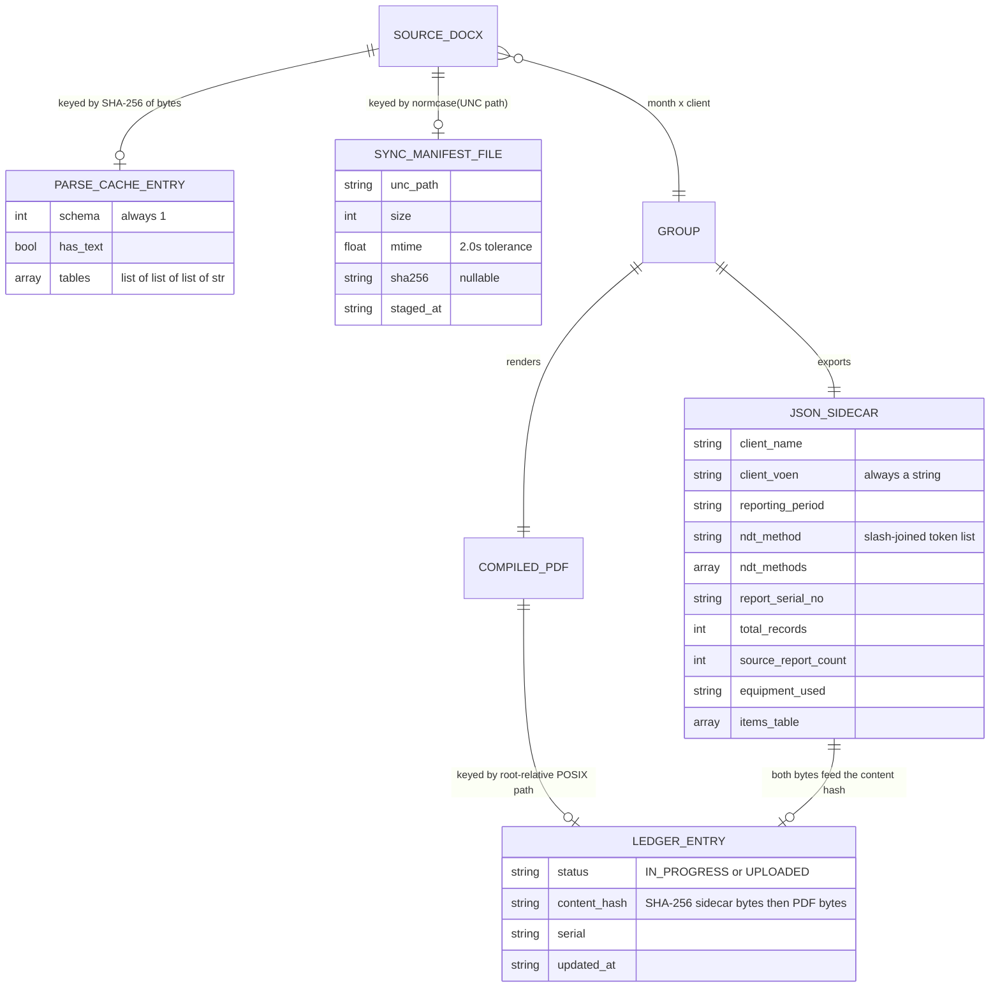

# Project Context

> **Evidence rule.** Every factual statement below carries a `path:line` citation to the code
> that proves it. Anything that could not be proven from the repository is written as
> `UNKNOWN / NEEDS VERIFICATION` rather than guessed. Nothing in this document was inferred
> from the project's prose documentation alone — where docs and code disagree, the code wins
> and the disagreement is recorded in [§29 Contradictions](#contradictions).
>
> Generated: 2026-09-03. Branch at time of writing: `feature/parse-cache-incremental-ingestion`.
> No source file was modified to produce this document.

---

## 1. Executive Summary

**Monthly Report Studio** is a single-operator Python 3.11+ automation suite that converts a
drop-folder of English `.docx` / `.pdf` Non-Destructive Testing (NDT) inspection reports into
print-ready **Azerbaijani** monthly PDF reports — one per (month × client), carrying every
NDT method that client had that month (ADR-004) — each
mirrored by a machine-readable JSON sidecar, and then files those reports into the Azerbaijani
state quality portal **E-Keyfiyyet** through gated Playwright browser automation
(`README.md:12-19`, `pyproject.toml:8`).

Scale and shape, measured rather than claimed:

| Fact | Value | Evidence |
|---|---|---|
| Tracked files | 165 | `git ls-files` |
| Python lines (entry points + `src/`) | ~14,300 | `wc -l` over `main.py`, `uploader.py`, `src/**` |
| Largest module | `uploader.py`, 3,428 lines | `wc -l uploader.py` |
| Test files / raw test functions | 44 / 920 | `tests/`, `grep -c "def test_"` |
| Git history | 8 commits total | `git log --oneline` |
| CI / CD | **none** | no `.github/`, no `Dockerfile`, no `Makefile`, no `tox.ini` |
| Database | **none** | no ORM, no migrations; state is JSON files ([§12](#12-database-architecture)) |
| Environment variables | **none** | only `QT_QPA_PLATFORM` in tests (`tests/test_console.py:17`) |

Corpus scale, measured on 2026-09-18 by a full `--force-rebuild` with
`filtering.merge_duplicate_identities` **off** (the default):

| Fact | Value | Evidence |
|---|---|---|
| Compiled sidecars in `output/` | **126** | count of `output/**/compiled_monthly_report_*.json` |
| Compiled rows across all of them | **3,271** | sum of `items_table` lengths |
| Files newly quarantined by this run | **0** | run log; the only two `[quarantine]` lines are refusals — see below |
| Transposed report-number groups | 231 (215 merge / 14 distinct / 2 undecided) | [ADR-005](architecture/ADR-005-duplicate-report-identity.md) |
| Rows if the merge switch were ON | 3,056 (measured, not derived) | [ADR-005](architecture/ADR-005-duplicate-report-identity.md) |

⚠ **Two figures that are easy to misread, corrected here.**

- **"quarantine 13" is not a per-run number.** It is the one-time *result* of the KB-1 /
  KB-1b date repair (2026-09-04): 81 files were quarantined as undatable, and after the
  repair 13 remained. It is a milestone in `TODO.md`'s KB-1b section, not a figure any
  later run reproduces. A healthy run quarantines **0** files, which is what the
  2026-09-18 run did.
- **"~3,250 rows" is stale.** The measured figure is **3,271** — a delta of **+21 rows**
  against the earlier measurement. The operator attributes the difference to new reports
  arriving from the LAN share; that attribution is not independently verified here, and
  "21 rows" is not the same claim as "21 reports".

The two `[quarantine]` lines the 2026-09-18 run does print are refusals, not moves:
`KF-MT-26-058` and `KF-MT-26-058R1` cite `DNV-ST-EN 273`, which is not on
`allowed_standards`, but a copy under the same name already sits in
`input/SKIPPED_REPORTS/`, so `quarantine()` returns False on the name conflict and both
files are **left in place**. Every run retries and every run refuses. Harmless and
permanent; recorded in `TODO.md`'s Pending Roadmap as an operator question
(should `DNV-ST-EN 273` be allowed?), never as something to fix by moving a file.

Three architectural commitments carry the system: (a) **configuration-first** — methods,
clients, standards, thresholds and inspector routing all live in `config/settings.yaml`, not in
Python (`method_registry.py:31-74`); (b) **idempotent side effects** — uploads are gated by a
SHA-256 content ledger with a two-phase checkpoint (`upload_ledger.py:26-37`); (c) **stdout is
a public interface** — the desktop GUI runs the backend as a child process and parses its
printed output to drive progress bars (`gui/services/progress.py:1-11`,
`gui/services/job_runner.py:243-275`).

The codebase is unusually clean by conventional metrics — **zero `TODO`/`FIXME`/`HACK` markers
in production code**, zero bare `except:`, and near-universal justification comments on every
swallowed exception. Its real debt is elsewhere: documentation drift, one suspected serial-number
bug ([§26](#26-known-bugs--issues)), no CI, an entirely untested Qt UI layer, and two files
carrying real client identifiers into version control ([§29](#29-risks--potential-problems)).

---

## 2. Product Purpose

The company performs NDT inspections (magnetic particle, ultrasonic, radiographic, dye
penetrant, ferrite, PMI, hardness) and must file a **monthly consolidated report per client**
with an Azerbaijani government regulator. Doing that by hand means re-reading dozens to hundreds
of English inspection documents per month, translating controlled terminology consistently,
merging them into one table, rendering an official PDF, and re-typing it into a state web form.

The suite automates all of it (`README.md:12-26`):

1. Ingest loose `.docx`/`.pdf` from `input/` (or an SMB LAN share) and sort them by method.
2. Filter to the target calendar month by detected inspection date.
3. Extract fields, translate to Azerbaijani against an authoritative dictionary.
4. Merge into one per-client model, tracing cross-month weld retests to their parent inspection.
5. Render a ReportLab PDF plus a JSON sidecar.
6. File the sidecar into E-Keyfiyyet, exactly once, with human confirmation.

The design premise stated in the code is that this is **a side effect on someone else's
production database** (`upload_ledger.py:3-18`), so most of the uploader's complexity is brakes,
not features.

---

## 3. Target Users

`UNKNOWN / NEEDS VERIFICATION` — no personas, user research, or roles document exists in the
repo. What can be established from the code:

| User | Basis |
|---|---|
| **The pipeline operator** — runs `python main.py` or the desktop dashboard, drags files in, reviews quarantine | `README.md:227-230`; the whole GUI (`gui/ui/pages/`) targets one local machine |
| **The uploader operator** — a person who must be physically present: they log into the portal by hand with Asan İmza, then confirm each appeal at a terminal prompt | `uploader.py:30-34`, `_confirm_before_save` (`uploader.py:2521-2568`) |
| **The signing director** — never touches the software; their identity-document values are typed into the portal form on their behalf | `config/settings.example.yaml:375-386` |
| **The inspector** — named in the report signature block; assignment is a config routing decision, not a software role | `inspector_registry.py:45-79` |

There is no multi-user, multi-tenant, or networked-service dimension anywhere in the codebase.

---

## 4. User Roles & Permissions

**The application has no authentication, no authorization, no user accounts, and no role
system.** This is verified, not assumed: there is no login screen in the GUI, no session
concept, no permission check, and no user table.

The word "role" appears in this system in only three unrelated senses:

| Sense | What it actually is | Evidence |
|---|---|---|
| Portal identity | The signing director's FİN + seriya nömrəsi typed into the government form. Not an app credential. | `config/settings.example.yaml:381-386`, `uploader.py:1801-1802` |
| Portal session | A browser profile directory holding a manually-obtained session cookie. The de-facto credential, held by the OS, never by this code. | `uploader.py:3072-3085`, `.gitignore:8` |
| Signature role | `"inspector"` / director keys in the rendered PDF signature block. Presentation only. | `document_aggregator.py:393-398`, `pdf_renderer.py:400-443` |

The **closest thing to a permission model** is the client allowlist, and it is enforced against
data, not people: `approved_clients` in `config/settings.yaml` is a strict, **fail-closed** gate
on the uploader — with a non-empty list, a client code that cannot be resolved is refused rather
than allowed through (`method_registry.py:301-325`, applied at `uploader.py:2295-2299` and
`uploader.py:2348-2350`).

---

## 5. Core Features

Status legend: **working** = implemented and covered by tests; **partial** = implemented, gaps
noted; **unknown** = present but unverified here.

| Feature | Description | Key files | Status |
|---|---|---|---|
| ~~PDF → DOCX pre-conversion~~ | **SUPERSEDED by ADR-003 (2026-09-07).** Was: multiprocessed `pdf2docx` conversion, 398.8s serial → 100.0s at 8 workers. Measured to mis-set the verdict on 15.2% of 630 pairs; the whole stage is gone | ~~`pre_processor.py:293-504`~~ | removed |
| PDF archiving + direct read | STAGE −1 moves any `.pdf` under `input/` to `input/PDF_ARCHIVE/`; STAGE 1 reads the ORIGINAL PDF, no conversion | `pre_processor.py:154`, `main.py:507`, `pdf_reader.py` | working |
| Two-reader agreement gate | B1 (`find_tables`) + B3-C (word grid) must agree on the verdict; disagreement quarantines and is written to `output/pdf_crosscheck_<date>.md`. Measured silent errors on 630 pairs: **0** | `pdf_crosscheck.py`, `main.py:565-580` | working |
| Filename identity warning | A PDF name whose leading token is not the whole Report № is reported, never cleaned — `[identity]` console line + `output/identity_warnings_<date>.md` | `report_identity.identity_noise`, `main.py:632-650` | working |
| Method sorting registry | Config-driven regex routing of files into method folders; first match wins, longest token first | `method_registry.py:541-559`, `pre_processor.py:507-573` | working |
| Housekeeping / self-healing | Three SHA-256-verified prune passes; nothing is deleted, only moved to `input/_PRUNED/` | `pre_processor.py:797-970` | working |
| Persistent parse cache | Content-addressed `.docx` parse memoization keyed by SHA-256; errors are never cached | `parse_cache.py:173-255` | working |
| Incremental compilation | A group whose sources are unchanged keeps its existing PDF+JSON instead of re-rendering | `main.py:231-251`, `main.py:632-646` | working |
| Date detection + month filter | Integer-run heuristic, then `dateutil` fuzzy fallback | `date_detector.py:25-62` | working |
| Field extraction | Header-driven table reading; never a fixed column index | `extractor.py:132-494` | partial — **hardcoded, not config-driven** ([§29](#contradictions)) |
| Azerbaijani translation | Authoritative JSON dictionary; unmatched prose flagged `[AZ?]`, never dropped | `translator.py:17-52` | working |
| Cross-month retest tracing | Pulls the latest rank-0 parent strictly before a retest's date | `retest_tracker.py:31-86` | working |
| PDF rendering | Fixed 6-column ReportLab layout, embedded DejaVu TTF for `ə ğ ı ö ş ç ü` | `pdf_renderer.py:338-470` | partial — only 3 tests, both on private helpers |
| JSON sidecar export | Machine-readable twin of every PDF; `client_voen` always a string | `json_exporter.py:39-89` | working |
| Upload ledger | SHA-256 over sidecar+PDF bytes, two-phase `IN_PROGRESS`/`UPLOADED` checkpoint | `upload_ledger.py:105-126`, `:330+` | working |
| Portal uploader | Playwright form fill with three independent safety brakes | `uploader.py:1663-1859`, `:2624-2811` | working (live-verified per `TODO.md:88`) |
| Zero-substitution standards gate | A standard the portal does not offer is never stood in for; the report is skipped whole | `uploader.py:1312-1380`, `:1706-1725` | working |
| Desktop dashboard | PySide6 4-page cockpit; runs the backend as a child process | `gui/ui/main_window.py`, `gui/services/job_runner.py` | partial — **zero UI tests** ([§20](#20-testing)) |
| LAN share ingestion | Read-only SMB sweep with an O(1) metadata fingerprint registry. **A4-V2 (2026-09-18):** content dedup in the MODIFIED branch — a share file recorded before whose size or mtime moved. Where exactly one live local copy exists it is overwritten in place, as before. Where there is none, the copy used to be staged blind as a `-lan` twin — the root of the `-lan` artefact; its SHA-256 is now checked against the live twins, then the settled trees, then the parse-cache digests, and identical bytes are deleted again and counted as `skipped_dupes` with the matching path named in the log. A timestamp-only touch is re-fingerprinted and counted `unchanged`. **Twin path only**; the `.docx`-over-`.pdf` twin preference is still missing from `sync_from_lan` (`TODO.md`, Pending Roadmap) | `services/network_ingestion.py:362-513`, `:467-524` | working |
| Transposed report-№ merge | **Opt-in, OFF by default.** `RT-U-25-090` and `U-RT-25-090` are one number in two orders; the module merges such a pair only when the two documents' **weld identifiers** prove they are one report. Disjoint weld sets = two real inspections and are left alone; an undecidable pair keeps both rows and is named in `report.skipped` under `DUPLICATE_IDENTITY_UNDECIDED`. Measured: 231 groups → 215 merge / 14 distinct / 2 undecided. Never writes, moves or renames a file | `duplicate_identity.py`, `document_aggregator.py:408`, [ADR-005](architecture/ADR-005-duplicate-report-identity.md) | working (off) |
| Executive summary PDF | KPI/chart report over live state | `generate_pipeline_summary.py` (1,206 L) | working |
| Inspector worksheet | Assignment-matrix PDF | `generate_inspector_worksheet.py` (260 L) | partial — orphan: no tests, absent from `CLI_MANUAL.md` |
| Destructive input reset | Wipes `input/`, manifest, parse cache; re-syncs from a cutoff | `reset_and_sync_input.py:73-124` | partial — **zero tests on a destructive path** |

---

## 6. User Flows

### Flow A — unattended monthly compile

```
python main.py [--month JUN_2026] [--method UT] [--client CLIENT_A] [--no-clean] [--force-rebuild]
```

| Step | What happens | Where |
|---|---|---|
| 1 | UTF-8 console enabled (report names carry Azerbaijani glyphs) | `main.py:322`, `console.py:34-45` |
| 2 | `--month` normalized: accepts `2025-06`, `26-08`, `JUN_2025`, `JUN 2025`; anything else exits 2 | `main.py:253-278` |
| 3 | **STAGE 0-LAN** — optional read-only sweep of SMB shares into `input/`; wrapped so a dead share can never abort a local run | `main.py:349-378`, `network_ingestion.py:362-513` |
| 4 | **STAGE -1** — PDFs converted to `.docx` across a bounded process pool; originals archived | `main.py:382`, `pre_processor.py:293-504` |
| 5 | **STAGE 0** — loose `.docx` sorted into method folders; ASR/ARS quarantined on sight | `main.py:395`, `pre_processor.py:507-573` |
| 6 | **STAGE 0.5** — housekeeping (skipped by `--no-clean`) | `main.py:417-425` |
| 7 | **STAGE 1** — parse, cache-first; read failures and textless (scanned) files quarantined | `main.py:437-499` |
| 8 | **STAGE 2** — group discovery in two passes with a volume snapshot taken between them | `main.py:501`, `pre_processor.py:576-730` |
| 9 | Post-discovery sweeps: stale output for retired/low-volume clients retired — **unless the upload ledger has it on record** | `main.py:508-536`, `upload_ledger.py:146-171` |
| 10 | **STAGE 3** — per group: aggregate → gate → render PDF → write JSON sidecar, or print `[Incremental Skip]` | `main.py:576-667` |
| 11 | Exit `0`, or `1` when no group matched | `main.py:542-547`, `main.py:688` |

**Load-bearing ordering rule:** only stages *before* group discovery may touch `input/`. This is
what makes repeated runs deterministic; violating it once produced group counts of 104 → 102 →
101 across three consecutive runs (`pre_processor.py:693-702`, regression-pinned by
`tests/test_pipeline_determinism.py:135`).

### Flow B — desktop dashboard run

| Step | What happens | Where |
|---|---|---|
| 1 | `python gui_launcher.py`; dispatch happens **before Qt is imported** | `gui_launcher.py:32-43` |
| 2 | Settings load fail-fast → a `QMessageBox`, not a traceback | `gui/app.py:48-51` |
| 3 | Operator picks Month / Method / Client from dropdowns populated by scanning `output/` filenames | `gui/services/catalog.py:143` |
| 4 | **Run Pipeline** → `QProcess` starts `python -u gui_launcher.py --worker pipeline <filters>` | `gui/services/job_runner.py:141-157`, `:212-222` |
| 5 | Child rebinds `main._ROOT` to the app root before calling `main.main(args)` | `gui/worker_entry.py:51-62` |
| 6 | Child stdout is decoded incrementally, ANSI-stripped, regex-parsed into two progress tracks | `job_runner.py:243-275`, `progress.py:195-365` |
| 7 | Cancel kills the whole process tree via `taskkill /PID <pid> /T /F`, then sweeps `*.part` | `job_runner.py:159-209` |

### Flow C — portal upload

| Step | What happens | Where |
|---|---|---|
| 1 | `python uploader.py --dry-run --all` — no browser, no network, own separate ledger | `uploader.py:3213-3219`, `:2141-2150` |
| 2 | `--live` refuses to start until `portal.director` is filled — **before a browser opens** | `uploader.py:3161-3162`, `:693-715` |
| 3 | Target resolution gates in order: date cutoff `>= 2025-12-01` → retired clients → `approved_clients` allowlist → volume floor | `uploader.py:2264-2389` |
| 4 | Standards pre-flight: unmatched → `SKIPPED_UNMATCHED_STANDARD`; all-blank → `SKIPPED_EMPTY_STANDARD`. Nothing typed, **no ledger entry**, so it re-offers on every later run | `uploader.py:1706-1725` |
| 5 | Chrome opens against the persistent profile at the **public** landing page; operator logs in by hand (Asan İmza, handset round-trip), up to 900s | `uploader.py:3088-3132`, `:2940` |
| 6 | Form filled: role radio → VÖEN (portal auto-fills client name from the tax DB) → dates → caption-anchored free-text fields → file attach | `uploader.py:1740-1822` |
| 7 | `--interactive`: run stops and asks `[Enter]/y` save · `s` skip · `q` quit. EOF or Ctrl-C ⇒ quit, never save | `uploader.py:2521-2568` |
| 8 | CHECKPOINT 1 `mark_in_progress` → click `Yadda saxla` → await redirect to `/uqq/projects` → CHECKPOINT 2 `mark_uploaded` | `uploader.py:2709-2710`, `:1859`, `:1062`, `:2804` |
| 9 | **`E-imza ilə təsdiqlə` is never located and never clicked.** Signing stays a human decision | `uploader.py:27-28`, `:1679-1682` |

---

## 7. Technology Stack

| Concern | Choice | Constraint | Evidence |
|---|---|---|---|
| Language | Python | `>=3.11` | `pyproject.toml:10` |
| `.docx` parsing | `python-docx` | `>=1.1.2` | `pyproject.toml:15` |
| PDF generation | `reportlab` (Platypus) | `>=4.2.0` | `pyproject.toml:16` |
| PDF reading | `PyMuPDF` (`fitz`) — direct, explicit dependency | `>=1.24` | `pyproject.toml:21`, `requirements.txt:8` |
| ~~PDF → DOCX~~ | ~~`pdf2docx` (pulled PyMuPDF, OpenCV, numpy)~~ — **SUPERSEDED by ADR-003 D3**, removed with OpenCV and numpy | — | `ADR-003` D3 |
| Date parsing | `python-dateutil` | `>=2.9.0` | `pyproject.toml:18` |
| Config | `PyYAML` | `>=6.0.1` | `pyproject.toml:17` |
| Browser automation | `playwright` (Chromium, sync API) | `>=1.44.0` | `pyproject.toml:22` |
| Desktop UI | `PySide6` (Qt 6, LGPL) — **optional extra** | `>=6.10.0` | `pyproject.toml:29` |
| Tests | `pytest` | `>=8.2.0` | `pyproject.toml:26` |
| Packaging | `pyinstaller` — build-time only | `>=6.16.0` | `pyproject.toml:30` |
| Build backend | `setuptools>=68` + `wheel`, src-layout | — | `pyproject.toml:1-3`, `:36-37` |

Deliberately **absent**: no web framework, no database, no ORM, no message queue, no container
runtime, no cloud SDK, no `.env` loader, no logging framework, no HTTP client.

---

## 8. Project Architecture

Four layers, one direction of dependency (with one violation, noted below):

```
  root scripts        main.py · uploader.py · gui_launcher.py · generate_*.py · reset_and_sync_input.py
       │
       ▼
  package core        src/monthly_report/*.py        (pipeline: config, readers, extractor,
       │                                              aggregator, renderer, exporters, registries)
       ▼
  package services    src/monthly_report/services/   (LAN ingestion + fingerprint registry)

  optional GUI        src/monthly_report/gui/        ui/ (QtWidgets) → services/ (QtCore only) → backend
```

### The three decisions that shape everything

**1. Stdout is a public interface.** Neither `main.py` nor `uploader.py` exposes a progress
callback. The GUI therefore runs them as child processes and parses their printed lines with
regexes anchored to the actual `print` statements (`gui/services/progress.py:1-11`,
`:111-167`). Consequence: rewording a console message can silently break a progress bar. This is
an accepted, documented risk (`architecture/ADR-002-gui-frontend.md:303-315`) pinned by
`tests/test_gui_progress.py` and `tests/test_progress_counters.py:313`.

**2. Child process, never a thread.** Three concrete reasons are recorded in
`architecture/ADR-002-gui-frontend.md` D2: `docx_reader.read_many` drives a
`ProcessPoolExecutor`; `sys.stdout` is process-global and `pre_processor.warn` calls `isatty()`
(`pre_processor.py:92-101`); and threads cannot be killed. Implementation:
`gui/services/job_runner.py:141-157`.

**3. `_ROOT` injection prevents silent data loss.** Under PyInstaller `--onefile`,
`main.__file__` resolves inside `%TEMP%\_MEIxxxxx\`, so `project_root` would become a directory
Windows deletes on exit — every generated report lost, on a build that otherwise appears to
work. `gui/worker_entry.py:61,70` rebinds `main._ROOT` and `uploader._ROOT` to the executable's
own directory (`gui/services/app_paths.py:37-46`). ADR-002 D3 calls this "the load-bearing
decision".

### Layering rules (enforced by convention, not tooling)

- `gui/services/` may import `QtCore`, **never `QtWidgets`** (`gui/services/__init__.py:3-6`).
  `progress.py` and `ansi.py` import no Qt at all, which is what makes them unit-testable headless.
- Policy ("one job at a time") lives in `main_window.py`, not in the pages
  (`main_window.py:1-10`, guards at `:323`, `:367`, `:640`).
- All PDF layout is isolated in `pdf_renderer.py` (`architecture/ADR-001-tech-stack.md:99`).
- `_retire_artifacts` (`main.py:128-150`) is the **single deletion seam** for compiled output.

**Violation:** `main.py:67` imports `from monthly_report.gui.services.catalog import _parse_stem`
— the core pipeline reaching into a *private* function of the *optional GUI* package. See
[§29 Contradictions](#contradictions).

---

## 9. Folder & File Structure

```
Monthly-Report-Auto/
├── main.py                      ROLE: the real orchestrator. 8 stages, scoping, housekeeping,
│                                      render loop, ledger-protected output retirement. (692 L)
├── uploader.py                  ROLE: E-Keyfiyyet portal automation — target gates, standards
│                                      matching, form fill, ledger checkpoints. (3,428 L)
├── gui_launcher.py              ROLE: dual-mode entry — dashboard, or `--worker` child dispatch
│                                      before Qt is imported. Holds `freeze_support()`. (53 L)
├── generate_pipeline_summary.py ROLE: executive KPI/chart PDF over live state. (1,206 L)
├── generate_inspector_worksheet.py ROLE: inspector-assignment worksheet PDF. (260 L, orphan)
├── discover_network_share.py    ROLE: read-only SMB share scanner; also the library of share
│                                      primitives that network_ingestion reuses. (695 L)
├── reset_and_sync_input.py      ROLE: destructive operator reset + cutoff re-sync. (234 L)
│
├── src/monthly_report/          ROLE: the pipeline package (importable, src-layout)
│   ├── config.py                    settings load + path resolution + fail-fast validation
│   ├── cli.py                       legacy single-report console script (see §29)
│   ├── console.py                   UTF-8 console, safe_print, progress_printer
│   ├── pre_processor.py             convert / sort / housekeep / discover_groups (970 L)
│   ├── docx_reader.py               parallel .docx → table matrix
│   ├── parse_cache.py               content-addressed parse memoization
│   ├── extractor.py                 header-driven field extraction (494 L)
│   ├── date_detector.py             inspection-date detection + month test
│   ├── document_aggregator.py       STAGE 3 business core: filter chain → rows → report (463 L)
│   ├── retest_tracker.py            cross-month parent pulling
│   ├── method_registry.py           ALL config-driven registries + gates (559 L)
│   ├── inspector_registry.py        inspector assignment / date routing
│   ├── report_identity.py           report-number identity, retest ranks, ASR/ARS exclusion
│   ├── duplicate_identity.py        opt-in transposed-№ merge, weld-evidence driven (ADR-005)
│   ├── naming.py                    folder constants, output paths, document serial
│   ├── text_norm.py                 Azerbaijani dotted-İ folding
│   ├── translator.py                dictionary translation + untranslated flagging
│   ├── json_exporter.py             JSON sidecar contract
│   ├── pdf_renderer.py              ALL PDF layout (470 L)
│   ├── upload_ledger.py             idempotency ledger + two-phase state machine
│   ├── services/                ROLE: LAN ingestion subsystem
│   │   ├── network_ingestion.py     two sync engines over one manifest (746 L)
│   │   └── ingestion_registry.py    O(1) metadata fingerprint manifest
│   └── gui/                     ROLE: optional desktop dashboard
│       ├── app.py                   composition root, fail-fast settings dialog
│       ├── worker_entry.py          child-process entry; injects _ROOT into main/uploader
│       ├── services/                ROLE: Qt-Core-only logic — process runner, stdout parsers,
│       │                                  disk scans, settings writer, ledger projection
│       └── ui/                      ROLE: QtWidgets — theme, widgets/, pages/ (4 pages)
│
├── config/
│   ├── settings.example.yaml    ROLE: committed template, heavily commented (441 L)
│   ├── settings.yaml            ROLE: real values — GIT-IGNORED
│   └── fields.yaml              ROLE: **orphaned** — no Python file reads it (see §29)
├── translations/az.json         ROLE: authoritative EN→AZ terminology dictionary
├── assets/fonts/                ROLE: DejaVu TTFs (binaries not committed)
├── images/                      ROLE: header logo + stamp rendered onto the PDF
├── architecture/                ROLE: ADR-001 (tech stack), ADR-002 (GUI frontend),
│                                      ADR-003 (direct PDF extraction), ADR-004 (client
│                                      grouping), ADR-005 (transposed-№ merge),
│                                      ADR-006 (pulled parent), ADR-007 (pull weld
│                                      check), ADR-008 (report-№ mismatch),
│                                      ADR-009 (by-number ranges)
├── standarts/                   ROLE: standards registries as data + portal-request generator
├── tests/                       ROLE: 44 pytest files, no conftest.py
├── .agents/skills/              ROLE: 17 in-repo AI skill definitions
├── input/  output/              ROLE: runtime trees — contents git-ignored
└── .state/  .parse_cache/       ROLE: machine-local persistent state — git-ignored
```

---

## 10. Frontend Architecture

**Framework:** PySide6 / Qt 6 (`gui/app.py:13-14`). Chosen over PyQt6 as a *licensing* decision —
LGPL vs GPL-or-commercial — explicitly not a technical one
(`architecture/ADR-002-gui-frontend.md` D1). CustomTkinter was rejected on visual ceiling and
missing table/process APIs; Flet was **disqualified** because it serves the UI over local
HTTP/WS, violating a zero-server requirement.

**Navigation:** a 4-item `QStackedWidget` driven by a `QButtonGroup` sidebar that knows nothing
about page content (`main_window.py:31-34`, `:231-249`, `ui/widgets/sidebar.py:14-59`).

| Page | File | Purpose |
|---|---|---|
| Dashboard | `ui/pages/dashboard_page.py` (484 L) | Metric cards, scope filters, drop zone, Run/Upload controls, two progress bars, live console |
| Uploader / Registry | `ui/pages/uploader_page.py` (558 L) | 3-mode segmented control, limit/slow/force options, the ledger as a table |
| Quarantine | `ui/pages/quarantine_page.py` (350 L) | Lists `input/SKIPPED_REPORTS/`, opens files in Word for OCR repair |
| Settings | `ui/pages/settings_page.py` (336 L) | Health checklist, cache purge, theme, and the **only** editable config block (director) |

**Wiring:** all page↔service connections are centralized in `main_window._connect`
(`main_window.py:278-313`). Pages emit intent signals; the window owns policy.

**Off-thread work:** filesystem scans, drag-and-drop ingestion and metric recounts run on a
`QThreadPool` as `QRunnable`s, each held in a set on the window because the pool owns the C++
runnable but not the Python wrapper (`main_window.py:103-208`).

**Console widget:** rolling `QPlainTextEdit` capped at 5,000 lines, honouring ANSI spans from the
uploader and applying its own regex colour rules to the pipeline's uncoloured output
(`ui/widgets/console_view.py:29-103`).

**Localization scope — important:** `translations/az.json` is **pipeline/PDF content only**. The
GUI's own strings are hardcoded English (`ui/pages/dashboard_page.py:68-71`); nothing under
`gui/` loads `az.json`. The GUI only registers DejaVu fonts so Azerbaijani glyphs render
(`ui/theme.py:124-140`).

---

## 11. Backend Architecture

### Stage sequence in `main.py`

| Stage | Function | Line | Contract |
|---|---|---|---|
| 0-LAN | `network_ingestion.sync_from_lan` | `main.py:349-378` | Blanket `except Exception` — a dead share must never abort a local run |
| −1 | `pre_processor.archive_input_pdfs` | `main.py:507` | **ADR-003:** no conversion. Any `.pdf` under `input/` is moved to `input/PDF_ARCHIVE/` and read there. (Was `convert_input_pdfs`, superseded 2026-09-07) |
| 0 | `pre_processor.sort_input_files` | `main.py:395` | Returns `{moved, unmatched, conflict, quarantined}`; `shutil.move`, never clobbering |
| 0.5 | housekeeping (3 passes) | `main.py:417-425` | Every disposal is SHA-256-verified and goes to `input/_PRUNED/` |
| 1 | parse (cache-first) | `main.py:437-475` | Errors are never cached (`parse_cache.py:241`); textless files quarantined and popped from cache |
| 2 | `pre_processor.discover_groups` | `main.py:501` | Two passes with the volume snapshot taken between them; key `(month, client)` |
| — | output sweeps | `main.py:508-536` | `_retire_artifacts` is the single deletion seam; ledger-protected keys are kept and announced |
| 3 | render loop | `main.py:576-667` | Per group: aggregate → gates → serial → incremental skip or render+export |

### Key subsystem behaviours

**Parse cache** (`parse_cache.py`) — SHA-256 of file bytes → `.parse_cache/<sha256>.json`
holding `{"schema":2,"has_text":bool,"tables":[[[str]]]}` (`:126`). **Schema 1 → 2 under
ADR-003 D4:** the shape is unchanged but its meaning is not — the grid is now the original
PDF's, not a shattered conversion's, so every pre-migration entry must miss. Misses are
delegated to `docx_reader.read_many` in one batch (`:228-229`), which dispatches on suffix
to `pdf_reader` or `docx_reader`. A PDF whose two readers disagree is **never stored**. Writes are tempfile → `flush` → `fsync` →
`os.replace` (`:128-147`).

**Group discovery** (`pre_processor.py:576-730`) — the key is `(month, client)` (ADR-004);
the methods a group contains ride along as a reporting-only 4th tuple field and never enter
the key. Pass 1 quarantines: ASR/ARS, undatable, retired/inactive client, filename standard
not on `allowed_standards`. Pass 2 applies the corpus volume gate and — importantly —
**leaves failures in place rather than quarantining them** so low-volume clients accumulate
months. The two-pass split and the volume snapshot between them are unchanged: the snapshot
was always client-keyed (`method_registry.corpus_client_stats`), so the method never entered
the determinism fix.

**Aggregation** (`document_aggregator.py:200-417`) — a filter chain where every rejection is
recorded in `report.skipped`: unreadable → month → ASR/ARS → method → inactive client → corpus
volume → client mismatch → duplicate report № → lenient standards gate (`:254-331`). The module
is read-only by contract; it never moves or deletes a source (`:11-19`).

**Sequence numbering** (`document_aggregator.py:420-454`) — parents `1,2,3…`, matched retests
`4a,4b`, orphan retests get their own index and an `is_orphan_retest` flag.

### Error handling posture

Every durable writer (`parse_cache.put`, `ingestion_registry.write_manifest`,
`upload_ledger._flush`) uses the identical tempfile → fsync → `os.replace` pattern. Broad
`except Exception` appears only at degradation seams and carries a justification comment at
nearly every site ([§24](#24-error-handling--logging)).

---

## 12. Database Architecture

**There is no database.** No SQL, no ORM, no migrations, no schema DDL, no connection string
exists anywhere in the repo. Durable state is a set of JSON files on the local filesystem, all
git-ignored.

| Store | On-disk shape | Writer | Reader |
|---|---|---|---|
| `.parse_cache/<sha256>.json` | `{"schema":1,"has_text":bool,"tables":[[[str]]]}` | `parse_cache.py:118-147` | `parse_cache.py:97-116`; digest index by `network_ingestion.py:168-174` |
| `.state/network_sync_manifest.json` | `{"version":2,"cutoff":str\|null,"entries":{sha256:{name,date,staged_at}},"files":{normcase(unc):{unc_path,size,mtime,sha256,staged_at}}}` | `ingestion_registry.py:237-251` | `ingestion_registry.py:165-178`; deleted by `reset_and_sync_input.py:114-117` |
| `.upload_state.json` | `{"version":1,"entries":{<root-relative POSIX pdf path>:{status,content_hash,serial,updated_at}}}` | `uploader.py` via `upload_ledger._flush` | **read-only** by `main.py:518` → `protected_keys` (`upload_ledger.py:146-171`, fails **open**) |
| `.upload_state.dryrun.json` | same shape, separate file so simulating can never suppress a real upload | `upload_ledger.py:63-64`, `uploader.py:2141-2150` | same |
| `output/upload_status.json` | JSON array of `{…,"status":…}` — human audit trail | `uploader.py` | `generate_pipeline_summary.py:474-483` |
| `output/**/*.json` (sidecars) | see `json_exporter.py:46-73` | `json_exporter.py:76-89` | `main.py:179`, `generate_pipeline_summary.py:376-399`, `uploader.py` |
| `.state/cache_stats.json` | `{"hits":int,"misses":int,"recorded_at":iso}` | `gui/services/cache_stats_service.py:31,62,75` | GUI + summary |
| `.state/metrics_history.json` | `{"documents","pdfs","sidecars","quarantined","recorded_at"}` | `gui/services/metrics_history_service.py:36,93,108` | GUI |
| `.state/quarantine_reasons.json` | `{"tags":{filename:reason},"recorded_at":iso}` | `gui/services/quarantine_reasons_service.py:34,76,98` | GUI |

### Entity relationships



**Identity rule that matters:** a report is identified by *content*, not timestamp — the ledger
hash is SHA-256 over the sidecar's bytes followed by the PDF's bytes
(`upload_ledger.py:105-126`). A regenerated report after a data correction is therefore detected
and re-uploaded rather than skipped forever.

---

## 13. API Architecture

**This project exposes no API.** No HTTP server, no REST/GraphQL/gRPC endpoint, no route table,
no controller layer. Nothing listens on a port.

The only network-facing surface is **outbound**: `uploader.py` drives the E-Keyfiyyet appeal
form through a browser. The equivalent of an endpoint table is therefore the form-control map.

| Portal control | Locator strategy | Auth required | Source |
|---|---|---|---|
| `/uqq/new-appeal` (target route) | waited for, never navigated to cold | yes — session cookie in the persistent profile | `uploader.py:447`, `:3095-3099` |
| `/home` (landing route) | actually opened; operator logs in here | no | `uploader.py:3088-3108` |
| `/uqq/projects` (success signal) | redirect awaited to confirm a save | yes | `uploader.py:1062`, `:455` |
| "Hüquqi şəxs" role radio | `get_by_role("radio", name=…)` | yes | `uploader.py:1747` |
| VÖEN field | `get_by_placeholder("VÖEN")` — blur triggers the portal's own tax-DB lookup | yes | `uploader.py:1748` |
| Date fields | `get_by_placeholder("DD.MM.YYYY")` | yes | `uploader.py:1740` |
| Director FİN / Seriya nömrəsi | placeholder anchors; the portal auto-fills the three name boxes from the registry lookup | yes | `uploader.py:1801-1812` |
| "İnspeksiyanın olunan obyekt:" | **caption anchor** — the field has no accessible attribute, only a regenerating React `useId` | yes | `uploader.py:1763`, `_field_after_caption` `:1444` |
| "Nəticə:" / equipment note | caption anchor | yes | `uploader.py:1795-1799` |
| Standards listbox | live options are the source of truth; `PORTAL_STANDARDS` (16 entries, measured by `--probe` 2026-08-12 and reconciled against `output/portal_form_probe.json` in CI) is a dry-run oracle only. NOT the company master list — see `standarts/in_portal.md` vs `add_portal.md` | yes | `uploader.py:466-500`, `:1775-1788` |
| File attach | count-asserted file input | yes | `uploader.py:1818-1822` |
| `Yadda saxla` (save) | `get_by_role("button", name=/^Yadda saxla$/)` — only with `--live` | yes | `uploader.py:1859` |
| `E-imza ilə təsdiqlə` | **never located, never clicked** | — | `uploader.py:27-28`, `:1679-1682` |

**Locator provenance discipline:** every selector is mapped from `output/portal_form_probe.json`
and marked inline (`uploader.py:46-50`, `:1663-1665`). `_fill_verified` (`:1467`) types then
reads back with retries, because the portal's VÖEN blur lookup resolves with a pre-blur form
snapshot and wipes later fields (`:1754-1758`).

`README.md:688-711` proposes replacing this with a hidden JSON API if one is discoverable in
DevTools; that remains an open roadmap item (`TODO.md:105`).

---

## 14. Authentication & Authorization

**Application-level: none** ([§4](#4-user-roles--permissions)).

**Portal authentication is manual and persisted, never scripted.** The script never sees a
password (`uploader.py:30-34`). The flow:

1. `launch_persistent_context(user_data_dir=<portal.user_data_dir>, headless=False)` opens Chrome
   against a dedicated profile directory, default `.browser_profile/` (`uploader.py:3072-3085`).
2. The **public** landing page is opened, not the form — a cold `goto` to the form bounces to
   login and every locator then runs against a login page (`uploader.py:3095-3099`).
3. The operator logs in by hand (Asan İmza / e-İmza, including a confirmation round-trip on a
   handset via `mygovid.gov.az`). `_await_takeover` (`uploader.py:2940`) watches, with a budget
   of `portal.takeover_timeout_seconds`, default 900s — 300s was tried and proved insufficient
   (`config/settings.example.yaml:329-335`).
4. The session cookie persists in that directory; later runs reuse it.

CDP takeover of an everyday Chrome was rejected as unachievable: port 9222 exists only if Chrome
was *started* with the flag, and Chrome 136+ refuses it on the default profile
(`uploader.py:36-44`).

**Authorization equivalents — three independent brakes** (`uploader.py:10-28`):

| Brake | Effect | Source |
|---|---|---|
| `MAX_REPORTS_PER_RUN = 1` | Hard cap without `--live`. Lifts only for an interactive run or an explicit `--no-interactive` batch; an explicit `--limit` always wins | `uploader.py:196`, `:2589-2621` |
| `--live` required | Without it the form is filled and left for review; `Yadda saxla` is never clicked and the ledger is untouched | `uploader.py:1840-1843` |
| No e-signature, ever | The sign button is never located | `uploader.py:1679-1682` |

Plus the **fail-closed `approved_clients` allowlist**: with a non-empty list, an *unresolvable*
client code is refused, not allowed — the absence of an `if code:` guard is deliberate and
commented (`method_registry.py:314-318`, `uploader.py:2345-2347`).

---

## 15. State Management

No state-management framework (no Redux-analogue, no store, no observable graph). State lives in
three tiers:

| Tier | Mechanism | Evidence |
|---|---|---|
| **In-process, GUI** | Qt signals/slots. `JobRunner` emits `line`, `progress(str,int)`, `busy(str,bool)`, `stage(str)`, `detail(str,str)`, `quarantined()`, `started()`, `finished(int,bool)`. The progress *track* travels as a plain `str` to avoid Qt metatype registration | `job_runner.py:97-104`, `:92-95` |
| **Cross-process** | The child's **stdout**, parsed into `ProgressEvent(stage, percent, detail, quarantined, fatal, track)`. Two tracks (`INGEST`, `COMPILE`), each with a monotonic clamp so a bar never goes backwards; `percent=None` means indeterminate → a busy bar | `progress.py:29-45`, `:87-101`, `:170-192` |
| **Durable** | The JSON stores in [§12](#12-database-architecture) | — |

**In-process caching:** `method_registry` memoizes every derived registry on `id(settings.raw)`
(`method_registry.py:31-74`) — cheap and correct for a single settings object per process, but it
means a mutated-in-place `raw` dict would not invalidate.

**Deliberate per-group state reset:** `main.py:578` constructs a **fresh `Translator` per group**
so untranslated-segment tracking is per-report rather than cumulative (`translator.py:32`).

**Mutation to be aware of:** `settings.target_month` is *reassigned per group* inside the render
loop (`main.py:577`). Any code reading `settings.target_month` during STAGE 3 sees the current
group's month, not the CLI argument.

---

## 16. Third-Party Integrations

| Integration | Direction | Protocol | Config | Evidence |
|---|---|---|---|---|
| **E-Keyfiyyet state portal** | outbound, write | HTTPS via headed Chromium (Playwright) | `portal.url`, `portal.landing_url`, `portal.user_data_dir`, `portal.document_type`, `portal.standard_aliases`, `portal.director.*` | `uploader.py:3072-3132`, `config/settings.example.yaml:318-386` |
| **SMB / LAN client share** | inbound, **read-only** | UNC paths over SMB | `network_ingestion.lan_sources` | `network_ingestion.py:362-513`, `config/settings.example.yaml:429-441` |
| `mygovid.gov.az` | indirect | the operator's handset confirmation during Asan İmza login — not touched by this code | — | documented at `config/settings.example.yaml:329-334` |

No SaaS APIs, no analytics, no telemetry, no crash reporting, no payment, no email, no cloud
storage. The machine-translation hook in config is an explicit placeholder that no code reads
(`config/settings.example.yaml:417-420`).

**Scheduling:** no cron, no scheduler, no daemon. Every run is operator-initiated.

---

## 17. Environment Variables & Configuration

### Environment variables

**None.** This was verified by repo-wide grep for `os.environ` / `getenv` / `keyring` / `.env`
loading. The only assignments found are in tests (`QT_QPA_PLATFORM` at `tests/test_console.py:17`,
`tests/test_gui_pipeline_args.py:18`, `tests/test_housekeeping.py:303`), plus two variables the
GUI *forces on the child process* rather than reading:

| Variable | Where set | Purpose |
|---|---|---|
| `PYTHONUNBUFFERED=1` | `gui/services/job_runner.py:237` | So the stdout contract streams line-by-line |
| `PYTHONIOENCODING=utf-8` | `gui/services/job_runner.py:239` | Azerbaijani glyphs in child output |

`CLI_MANUAL.md:52` states the same: "Environment variables: None. There is no `.env` — all
configuration is YAML."

### Configuration keys (`config/settings.yaml`)

Values are never reproduced here — key names only.

| Key | Read at | Required? | Format |
|---|---|---|---|
| `target_month` | `config.py:85` | **yes** | `"YYYY-MM"` |
| `paths.input_dir` | `config.py:86` | **yes** | relative or absolute path |
| `paths.output_dir` | `config.py:87` | **yes** | path |
| `paths.translations` | `config.py:88`, `main.py:205` | **yes** | path to JSON |
| `paths.fonts_dir` | `config.py:67` | **yes** | path |
| `paths.images_dir` | `config.py:68` | no (default `images`) | path |
| `paths.fields_config` | — | no | **DEAD — read by nothing** ([§29](#contradictions)) |
| `branding.header_logo` | `config.py:80` → `pdf_renderer.py:187` | no | filename in `images_dir` |
| `branding.stamp_logo` | `config.py:81` → `pdf_renderer.py:453` | no | filename |
| `branding.report_title` | `config.py:95` | no | string |
| `branding.doc_number_pattern` | `config.py:96` → `naming.py:79` | no | `"MR-{client}-{yy}-{mm}"` — ADR-004 dropped `{method}`; it stays a supported placeholder for a custom pattern |
| `output.filename_pattern` | `config.py:97` | **yes (enforced)** | **but never consumed** ([§29](#contradictions)) |
| `performance.max_convert_workers` | `pre_processor.py:287` | no (default 8) | int |
| `performance.parse_cache` | `main.py:441` | no | bool |
| `performance.parse_cache_dir` | `main.py:442-443` | no | path (default `.parse_cache`) |
| `performance.incremental_compile` | `main.py:463` | no | bool |
| `performance.progress_every` | `main.py:114-125`, `:331` | no | int; `0` = counters off |
| `ndt_methods.<CODE>.folder` | `method_registry.py:56`, `:553` | per entry | string |
| `ndt_methods.<CODE>.patterns` | `method_registry.py:58`, `:554` | per entry | list of regex/substring; first match wins |
| `ndt_methods.<CODE>.informational` | `method_registry.py:119-126` | no | bool |
| `ndt_methods.<CODE>.default_standard` | `method_registry.py:523-538` | no | **DEAD in production** ([§29](#contradictions)) |
| `volume_thresholds.default` / ~~`.<METHOD>`~~ | `method_registry.py:201-206` | no | `{min_reports:int, min_items:int}`; OR-gate, `0` = off. **Per-method keys are DEPRECATED under ADR-004** — the render loop asks for the `default` floor, since one document spans every method. Kept in the example config, never looked up |
| `clients.<KEY>.{code,name,voen,prefixes,aliases,active}` | `method_registry.py:442-501` | no | `voen` **must be a quoted string** |
| `excluded_clients` | `method_registry.py:137` | no | list of client codes |
| `approved_clients` | `method_registry.py:183`, `:320` | no | list of codes; non-empty = fail-closed |
| `filtering.min_total_client_volume` | `method_registry.py:234-235` | no | int; `0` = off |
| `filtering.merge_duplicate_identities` | `duplicate_identity.py:79-82` | no (default **`false`**) | bool. Turning it on merges transposed report numbers and therefore **renumbers every `Sıra №`** of every affected month — `_assign_sequence_numbers` runs after the merge (`document_aggregator.py:408-410`). Read `output/report_no_collisions_<date>.md` before throwing it ([ADR-005](architecture/ADR-005-duplicate-report-identity.md)) |
| `allowed_standards` | `method_registry.py:356` | no | literals, or `^…$` / `\`-bearing regexes (single-quote them) |
| `inspector_matrix.clients` / `.date_routing` | `inspector_registry.py:58-78` | no | map; `date_routing` wins |
| `locale.date_format` | `config.py:98` | no | strftime |
| `locale.language` | — | no | **DEAD — read by nothing** |
| `fonts.regular` / `fonts.bold` | `config.py:71-72` | **yes, and the TTF must exist** | filename |
| `date_detection.dayfirst` | `config.py:99` → `date_detector.py:48` | no | bool |
| `date_detection.labels` | — | no | **DEAD** — `extractor._META_LABELS:23-42` is hardcoded |
| `translation.flag_untranslated` | `config.py:100` | no | bool |
| `translation.untranslated_marker` | `config.py:101` | no | string (default `[AZ?]`) |
| `translation.machine_translation.*` | — | no | **DEAD** — documented placeholder |
| `network_ingestion.lan_sources` | `network_ingestion.py:390`, `:654` | no | list of UNC paths |
| `portal.url` / `.landing_url` | `uploader.py:3146`, `:3121` | no | URL |
| `portal.takeover_timeout_seconds` | `uploader.py:3130-3131` | no (fallback 300) | int seconds |
| `portal.user_data_dir` | `uploader.py:3081` | no (default `.browser_profile`) | path — **holds the session cookie** |
| `portal.document_type` | `config/settings.example.yaml:340` | no | portal dropdown label |
| `portal.standard_aliases` | `uploader.py:1276` | no | `{portal option: [pattern,…]}` |
| `portal.director.{ad,soyadi,atasinin_adi,fin,seriya_nomresi}` | `uploader.py:670-674`, `:709` | **yes for `--live`** | identity-document values |

`config/settings.yaml` is git-ignored (`.gitignore:4`) and seeded from the example by
`setup.ps1:46-50` / `setup.sh:45-49`, never overwriting an existing file.

---

## 18. Dependencies

Only the load-bearing ones, with the reason each was chosen where the repo records one.

| Package | Why it is here | Recorded rationale |
|---|---|---|
| `python-docx` | Faithful paragraph/table/run model; **images are simply not read into the text model**, satisfying "ignore images" for free | `ADR-001-tech-stack.md` D1 |
| `reportlab` | The only PDF option simultaneously pip-only on Windows (zero native deps), deterministic for tables, and Unicode-complete for `ə ğ ı ö ş ç ü`. Typst was the documented runner-up, rejected for its external binary; WeasyPrint rejected on GTK/Pango/Cairo Windows install risk | `ADR-001` D2 |
| `PyMuPDF` (`fitz`) | Direct PDF reading — text layer, ruling lines (`find_tables`) and word coordinates. Was already present transitively; ADR-003 made it explicit | `ADR-003` D1/D3, `requirements.txt:8` |
| ~~`pdf2docx`~~ | **SUPERSEDED, removed (ADR-003 D3)** with OpenCV and numpy. Was: searchable-PDF → `.docx` conversion; its bitmap rendering is why the worker pool was capped at 8 and why one scanned PDF could peak near 1 GB. Measured to shatter table cells and mis-set 15.2% of verdicts | `ADR-003` §"What pdf2docx does to it" |
| `python-dateutil` | Fuzzy fallback for inspection-date detection after the integer-run heuristic | `date_detector.py:25-51` |
| `PyYAML` | All configuration | `config.py:61` |
| `playwright` | Resilient auto-waiting locators + persistent-profile auth. Sync API, imported lazily | `uploader.py:3322` |
| `PySide6` | LGPL — "a licensing decision, not a technical one" vs PyQt6. Optional extra: the pipeline and uploader run headless without it | `ADR-002` D1, `pyproject.toml:27-29` |
| `pytest` | The only quality gate that exists | `pyproject.toml:26` |
| `pyinstaller` | Build-time only; onefile Windows `.exe` (~170 MB, accepted risk) | `ADR-002` D1 |

**Asymmetry worth knowing:** `requirements.txt` installs *everything* including `pytest` and
`pyinstaller` (`requirements.txt:13-14`), while `pyproject.toml` splits them into `dev` / `gui` /
`build` extras (`pyproject.toml:25-30`). The comment at `pyproject.toml:19-20` records that
`pdf2docx` and `playwright` were originally missing from the project metadata entirely;
`pdf2docx` is now gone and `PyMuPDF>=1.24` sits in its place (`pyproject.toml:21`).

---

## 19. Build & Development Workflow

**Setup** — `setup.ps1` (Windows) and `setup.sh` (macOS/Linux) are idempotent mirrors: locate
Python → create or reuse `.venv` → activate → `pip install --upgrade pip` → `pip install -r
requirements.txt` → `pip install -e .` → `playwright install chromium` → copy
`config/settings.example.yaml` → `config/settings.yaml` **only if absent**
(`setup.ps1:11-50`, `setup.sh:10-49`).

**Fonts are a hard prerequisite.** `config.load_settings` raises `FileNotFoundError` if either
TTF is missing (`config.py:73-78`); binaries are intentionally not committed
(`.gitignore:78-79`).

**Run:**

```powershell
python main.py                                  # unattended, every discovered group
python main.py --month JUN_2025 --method UT     # scoped
python gui_launcher.py                          # desktop dashboard
python gui_launcher.py --worker pipeline        # headless, identical to python main.py
python uploader.py --dry-run --all              # no browser, no network
pytest -q                                       # the quality gate
```

**Build the `.exe`** — manual PyInstaller invocation documented at `README.md:264-317`. Three
things there are load-bearing:

- `--hidden-import main --hidden-import uploader` — `worker_entry` imports them lazily, so
  PyInstaller's static analysis cannot see them (`README.md:316-317`).
- **Never `--add-data config;config`** — bundling `config/` inside the executable makes
  `config.load_settings` resolve the project root to the temp extraction directory, so `output/`
  is written to a folder Windows deletes on exit (`README.md:300-306`).
- The verification step: run the frozen exe and confirm PDFs land in `.\output\`, never under
  `%TEMP%\_MEI*` (`README.md:310-314`).

No `.spec` file is committed (`.gitignore:66`), so the build is command-line-only and not
reproducible from the repo alone. `TODO.md:104` still lists exe packaging as open.

---

## 20. Testing

**Framework:** pytest only. Config is three lines — `testpaths = ["tests"]`,
`pythonpath = ["src"]` (`pyproject.toml:39-41`). **There is no `conftest.py` anywhere.**

**Volume:** 44 test files, 920 raw `def test_` functions, expanded further by heavy
`@pytest.mark.parametrize` use (23 parametrizations in `test_uploader_mapping.py` alone).

### Coverage highlights

| Well covered | Files |
|---|---|
| `uploader.py` | `test_uploader_form.py` (171 tests), `test_uploader_mapping.py` (107), `test_uploader_probe_contract.py`, `test_uploader_takeover.py` |
| `method_registry.py` | `test_method_registry.py`, `test_allowed_standards.py`, `test_client_exclusion.py`, `test_volume_thresholds.py`, `test_master_standards_sync.py`, `test_portal_readiness.py` |
| `network_ingestion.py` | `test_network_ingestion.py` (51 tests) |
| `upload_ledger.py` | `test_upload_ledger.py` (30 tests), `test_ledger_service_reset.py` |
| GUI **services** | every module has a test except `quarantine_service.py` |

### Untested modules

**Zero references anywhere in `tests/`:**

| Module | Lines | Why it matters |
|---|---|---|
| `reset_and_sync_input.py` | 234 | **Destructive** — deletes every child of `input/`, the manifest, and the parse cache |
| `gui_launcher.py` | 53 | Holds `multiprocessing.freeze_support()`, which ADR-002 calls load-bearing for frozen builds |
| `generate_inspector_worksheet.py` | 260 | Orphan script, also absent from `CLI_MANUAL.md` |
| `gui/app.py` | 59 | Composition root |
| `gui/services/quarantine_service.py` | 138 | The only untested GUI service |
| `gui/ui/**` (theme, 4 pages, 10 widgets) | ~2,700 | The entire Qt widget layer |

`grep` for `PySide6|QtWidgets|QtCore` across `tests/` returns **zero hits**. This is by design:
ADR-002 states the rule that `services` may import `QtCore` but never `QtWidgets`, and that the
parsers import no Qt at all so they can be unit-tested headless
(`architecture/ADR-002-gui-frontend.md:300-302`).

**Import-smoke only** (present solely in `tests/test_imports.py:7-25`): `cli.py`,
`translator.py`, `date_detector.py`, `retest_tracker.py`. Note `cli.py` is the **declared console
script** (`pyproject.toml:33`) and its `main()` is never exercised.

**Under-tested despite being designated critical:** `pdf_renderer.py` (470 lines) is where
ADR-001 says all layout must live, yet `test_pdf_renderer_header.py` has 3 tests, both targeting
private helpers.

### The three new, untracked test files

| File | Lines | What it pins |
|---|---|---|
| `tests/test_cli_manual_sync.py` | 152 | **Docs-as-data drift guard** — parses `CLI_MANUAL.md` and asserts bidirectionally against the real argparse parsers: every documented flag must be accepted (`:100`, `:108`), every parser flag must be documented (`:122`) |
| `tests/test_pipeline_determinism.py` | 448 | Regression suite for the 104→102→101 group-count drift; also asserts both `output/` deletion paths consult the ledger before deleting |
| `tests/test_progress_counters.py` | 395 | The `[Stage N] [i/total]` counters, including that a counter line must **not** be mistaken for a progress event by the GUI parser (`:313`) |

---

## 21. Deployment & Infrastructure

**There is no CI/CD of any kind.** Verified absent: `.github/workflows/`, `Dockerfile`,
`docker-compose.yml`, `Jenkinsfile`, `.gitlab-ci.yml`, `tox.ini`, `noxfile.py`, `Makefile`,
`.pre-commit-config.yaml`.

This matters because ADR-002 twice asserts "CI runs headless without it"
(`architecture/ADR-002-gui-frontend.md:55`, `pyproject.toml:28`) — **that CI does not exist**.
The "quality gate" is a manual `pytest -q`.

**Deployment target** is a PyInstaller onefile Windows `.exe`, still an open roadmap item
(`TODO.md:104`), built and verified by hand ([§19](#19-build--development-workflow)).
Data directories must be copied *beside* the executable, never bundled inside it
(`README.md:290-306`).

**Runtime infrastructure:** a single Windows workstation with access to the SMB client share and
a browser session on the portal. No servers, no containers, no orchestration, no secrets manager.

**Repo hygiene tooling that does exist:** `.gitattributes` (LF for `*.sh`/`*.py`/`*.md`, CRLF for
`*.ps1` — shell scripts break on macOS/Linux with `\r`), a thoroughly sectioned `.gitignore` with
per-block rationale, and `skills-lock.json` (locks 2 of the 17 skills present, with SHA-256
hashes).

---

## 22. Security

### What is handled well

| Control | Implementation |
|---|---|
| No password ever handled | Portal auth is manual + persisted; the script only opens a profile directory (`uploader.py:30-34`) |
| Secrets excluded from git | `config/settings.yaml`, `.env`, `.browser_profile/` all ignored (`.gitignore:4-8`) |
| Client documents excluded | `input/*`, `output/*` ignored with `.gitkeep` escapes (`.gitignore:16-22`) |
| Diagnostics excluded | `output/failures/` (screenshots + DOM dumps may contain client data) and `output/portal_form_probe.json` ignored (`.gitignore:48-50`) |
| Fail-closed upload allowlist | An unresolvable client code is refused when `approved_clients` is non-empty (`method_registry.py:314-318`) |
| No e-signature automation | Legally significant signing stays a human act (`uploader.py:1679-1682`) |
| Three independent upload brakes | `MAX_REPORTS_PER_RUN`, `--live` requirement, no e-imza (`uploader.py:10-28`) |
| Nothing is ever deleted from input | Housekeeping *moves* to `input/_PRUNED/`, SHA-256-verified (`pre_processor.py:797-814`) |
| Atomic config write with restore | `settings_writer` writes a `.bak`, lands via `os.replace`, then read-back-verifies or restores (`gui/services/settings_writer.py:280-307`) |

**No hardcoded secret was found.** A targeted grep for
`(api_key|apikey|secret|password|passwd|credential|access_key|private_key|auth_token|bearer)\s*[=:]`
across all `*.py|*.yaml|*.json|*.toml|*.ps1|*.sh` returned zero matches. The ~110 hits for the
word "token" are the domain sense — an NDT method token (`MT`, `UT`, `FC`) or a filename token.

### Sensitive locations (names only, no values)

| What | Where | Note |
|---|---|---|
| `portal.director.fin`, `.seriya_nomresi` | `config/settings.yaml`; read `uploader.py:673-674`; typed `uploader.py:1801-1802`; GUI-editable `gui/services/settings_writer.py:99-137` | Real identity-document values. Required for `--live` |
| Portal session cookie | `.browser_profile/` — the de-facto credential | Present in the working tree on this machine; git-ignored. **`UNKNOWN / NEEDS VERIFICATION`: git history was not audited to confirm it was never committed.** |
| `clients.*.voen` | `config/settings.yaml`; read `method_registry.py:468` | Client tax IDs, business-sensitive |

**Deliberate non-masking:** the Settings page shows FİN/serial in plain text, with the reasoning
recorded inline — the same values sit in plain text in a file this user owns
(`gui/ui/pages/settings_page.py:134-137`).

### Residual risk

The residual risk here is **data exposure, not credential leak** — see
[§29 Security risks](#security-risks).

---

## 23. Performance

| Optimization | Mechanism | Measured / configured |
|---|---|---|
| ~~Parallel PDF conversion~~ | **SUPERSEDED by ADR-003 (2026-09-07) — the stage no longer exists.** Was: `ProcessPoolExecutor`, **398.8 s serial → 100.0 s at 8 workers = 3.99×** (`ADR-002` D6), ceiling set by pdf2docx's single-threaded rendering | kept for history; nothing in the run path measures it any more |
| ~~Worker cap of 8, not core count~~ | **SUPERSEDED with the stage above.** Was deliberate: pdf2docx rendered pages to bitmaps via OpenCV and one large scanned PDF could peak near 1 GB per worker. No PDF is rendered to a bitmap any more; `max_convert_workers` no longer gates the run | `config/settings.example.yaml:53-59` (setting retained, inert) |
| Direct PDF reading | PyMuPDF text layer + `find_tables` + word grid, both readers per PDF, inside the existing parse pool | **Whole corpus, cold cache: 3,540 sources parsed in 91.0 s (39 files/s)**, ~502 of them PDFs read TWICE. Warm cache: 3,521 in 35.4 s. Per-PDF from `ADR-003`: `get_text` 11.1 ms, `find_tables` 251.6 ms |
| Parallel `.docx` parsing | `ProcessPoolExecutor` over `_read_one`, serial fallback on pool failure | `docx_reader.py:158-218` |
| Persistent parse cache | SHA-256 content key; a recurring monthly run re-parses only new/changed files, not the whole history sitting in `input/` | `parse_cache.py:173-255`; ~3,544 entries on disk |
| Incremental compilation | A group whose sources are all unchanged keeps its existing PDF+JSON instead of re-rendering identical bytes | `main.py:231-251`, `:632-646` |
| O(1) LAN skip | `IngestionRegistry.is_unchanged(unc, size, mtime)` with a 2.0 s mtime tolerance — no hashing, no read, for an unchanged remote file | `ingestion_registry.py:186-196`, `:52` |
| Dead-host caching | A down share costs exactly one timeout for the whole run | `network_ingestion.py:329-352` |
| One-pass index in the sorter | Existing `.docx` report keys indexed once rather than per-file | `pre_processor.py:348-350` |
| Registry memoization | Derived registries cached on `id(settings.raw)` | `method_registry.py:31-74` |
| Streaming hashes | 1 MiB chunks in both hashers | `parse_cache.py:65-80`, `upload_ledger.py:105-126` |

**~~Known slow path, accepted:~~** ~~PDF conversion runs roughly 30–40 s per page~~ — **gone with
ADR-003.** Reading the same page costs 11–252 ms. The corpus-wide conversion the old stage
implied (793 PDFs) was projected at ~52 min at 8 workers; the direct read parses the entire
3,540-file corpus, PDFs and `.docx` together, in **91 s** on a cold cache.

**Configurable console cost:** `performance.progress_every` at `1` emits one line per file during
both sorting and parsing, which is a lot of output on a thousand-report corpus; `0` disables the
counters entirely without affecting the per-stage summaries the GUI actually parses
(`config/settings.example.yaml:81-90`).

---

## 24. Error Handling & Logging

**There is no logging framework.** No `logging.getLogger`, no handler, no formatter, no log file
written by the application, and since ADR-003 **no `logging` usage at all**. The one that
existed was *defensive suppression* of `pdf2docx`, which called `logging.basicConfig(level=INFO)`
at import; it was neutralized in the parent and in every worker, with load-bearing ordering
explained inline. All of it went with the conversion stage.

**All output goes to stdout**, via two paths:

| Path | Behaviour | Where |
|---|---|---|
| `console.safe_print` | Flush-by-default; degrades gracefully on `UnicodeEncodeError` | `console.py:57-75` |
| Raw `print()` | Still used in ~12 sites | `pre_processor.py:339,368,370,398,630,632,716,728,811,813`; `docx_reader.py:211`; `method_registry.py:558`; all of `reset_and_sync_input.py` and `discover_network_share.py` |

The raw-`print` sites interpolate filenames carrying Azerbaijani glyphs and would raise
`UnicodeEncodeError` on a console where `enable_utf8_console` (`main.py:322`) failed to
reconfigure. **Nothing writes to stderr on failure** — a caller cannot distinguish narration from
an error by stream.

**Log files exist only by shell redirection.** `run1.log` (117 KB at repo root) is one such
capture — see [§29](#security-risks).

**Exception discipline** — measured, not assumed:

- **Zero bare `except:`** in the entire repo.
- **One `except BaseException`**, at `uploader.py:3238`, deliberate and commented: a fill-only
  run leaves the browser open on failure, a `--live` run re-raises (`:3239-3245`).
- **Seven `except Exception: pass`** sites, six with an inline justification. The exception is
  `generate_pipeline_summary.py:614-615`, which wraps ~7 lines including `getSize()` and
  `drawImage` with no comment and no log — a genuine ReportLab error is silently swallowed there.
- ~30 further narrow `except OSError: pass` sites, nearly all commented in the same idiom ("a
  dashboard metric is not worth failing a run's completion over",
  `gui/services/cache_stats_service.py:84`).
- Two uncommented narrow swallows: `date_detector.py:41-42` (falls through to the dateutil path,
  benign) and `discover_network_share.py:54-55`.

**Fail-open vs fail-closed, chosen per subsystem:** `upload_ledger.protected_keys` **fails open**
— an unreadable ledger protects nothing rather than blocking a run (`upload_ledger.py:146-171`).
`ingestion_registry` degrades rather than raising, explicitly contrasted with the ledger
(`ingestion_registry.py:26-31`). `config.load_settings` **fails fast** on any missing required
key or font (`config.py:42-49`, `:73-78`).

**GUI failure surfacing:** every escape path in the child funnels through `FATAL_PREFIX =
"[FATAL]"` (`gui/worker_entry.py:36`, `:83-113`), including a bare `SystemExit("message")` raised
by the uploader (`:97-104`), so the dashboard shows a message instead of a silent exit code.

**Portal failure diagnostics:** when a fill fails, a screenshot and DOM dump land in
`output/failures/` (`README.md:640-641`).

---

## 25. Current Technical Debt

| # | Item | Location | Impact |
|---|---|---|---|
| 1 | **No CI.** The claimed quality gate is a manual `pytest -q`; ADR-002 references a CI that does not exist | repo-wide; `ADR-002-gui-frontend.md:55` | **High** |
| 2 | **Documentation drift on test counts.** README says 504 in five places; `TODO.md:93` says 1,245 and `:99` says 1,345; the raw function count is 920 | `README.md:6,18,142,733,752`; `TODO.md:93,99` | **High** (the badge is the first thing a reader sees) |
| 3 | **`CLI_MANUAL.md` and its drift-guard test are untracked**, while the modified `README.md` now links to `CLI_MANUAL.md` twice — a fresh clone gets a broken link and loses the guard | `README.md:206`, `:525`; `git status` | **High** |
| 4 | **`reset_and_sync_input.py` has zero tests** despite being a destructive path | `reset_and_sync_input.py:73-124` | **High** |
| 5 | **The entire Qt UI layer is untested** — ~2,700 lines across theme, 4 pages, 10 widgets | `gui/ui/**` | Medium (deliberate per ADR-002, but still uncovered) |
| 6 | **No `conftest.py`.** Root-entry-point path bootstrapping is copy-pasted `sys.path.insert` across ~15 test files | `tests/test_cli_manual_sync.py:28-30`, `tests/test_uploader_form.py:30`, and others | Medium |
| 7 | **God files.** `uploader.py` 3,428 L; `generate_pipeline_summary.py` 1,206 L; `pre_processor.py` 970 L; `main_window.py` 892 L | — | Medium (ADR-002 forbids backend refactoring, so `uploader.py` is frozen by decision) |
| 8 | **Test files larger than the code they test.** `test_uploader_form.py` is 108 KB in a single file | `tests/test_uploader_form.py` | Medium |
| 9 | **Environment-coupled test** reads the machine's real, git-ignored `.upload_state.json` | `tests/test_pipeline_determinism.py:335` | Medium (will behave differently on a fresh clone) |
| 10 | **`pdf_renderer.py` under-tested** — 470 lines, designated by ADR-001 as the single home of all layout, 3 tests both on private helpers | `tests/test_pdf_renderer_header.py` | Medium |
| 11 | **Stdout as a load-bearing interface.** Rewording a `print` breaks a GUI progress bar | `progress.py:111-167` | Medium (accepted risk, ADR-002:303-315) |
| 12 | **Stale `file:line` citations in docstrings** — these are load-bearing "see X" pointers now aimed at the wrong code: `gui/services/catalog.py:9` cites `main.py:148` (actually `:577`); `catalog.py:62` cites `naming.py:41-52` (actually `:53-64`); `gui_launcher.py:27` cites `main.py:27-28` (actually `:59-60`); `gui_launcher.py:49` cites `docx_reader.py:184` (actually `:205`) | as listed | Low |
| 13 | **`sort_input_files` docstring contract drift** — says it returns 3 keys, returns 4, and `main.py:404` depends on the fourth | `pre_processor.py:519` vs `:572-573` | Low |
| 14 | **`SKILLS_MANIFEST.md` vs `skills-lock.json` divergence** — manifest registers 17 skills, lock file covers 2 | `SKILLS_MANIFEST.md`, `skills-lock.json` | Low |
| 15 | **Unused import** `datetime as _dt` | `src/monthly_report/cli.py:18` | Low |
| 16 | **Python version floor stated three ways** — 3.11+ in `pyproject.toml:10`, 3.10+ in `setup.ps1:17`/`setup.sh:15`, "3.14.6 verified" in `ADR-002:41` | as listed | Low |

---

## 26. Known Bugs / Issues

### B1 — Document serial can name the wrong month when a cross-month retest parent is pulled

**Severity: High (data correctness on an official document). Status: suspected — identified by
code reading, not reproduced at runtime.**

At `src/monthly_report/document_aggregator.py:361`:

```python
month_date = records[0].date if records else _dt.date.fromisoformat(settings.target_month + "-01")
```

and that value is passed to `document_number(...)` at `:402`, which derives `{yy}` and `{mm}`
from it (`naming.py:68-71`). Meanwhile `MonthlyReport.month` is set to `settings.target_month`
(`:401`).

A cross-month retest parent pulled in by `retest_tracker.pull_cross_month_parents` is rank 0 with
a date *strictly earlier* than the retest (`retest_tracker.py:76-79`), so it sorts first among
parents (`document_aggregator.py:425-432`) and lands at `records[0]` after
`records.sort(key=sort_key)` (`:356`). The rendered serial and the sidecar's `report_serial_no`
would then name the **previous** month while "Hesabat dövrü" names the target month.

**The codebase already knows this contamination exists.** The inspector lookup was deliberately
moved *off* `month_date` for exactly this reason, with the reasoning written out at `:386-392`,
and `tests/test_aggregator.py:135-136` asserts `"month_date" not in` the `resolve_inspector`
call, describing it as "contaminated by cross-month retest parents". The same fix was never
applied to `document_number`.

No test covers the serial in the pulled-parent case. **To confirm:** compile a group where a
retest pulls a parent from an earlier month and compare `report_serial_no` in the sidecar against
`reporting_period`.

### B2 — `generate_pipeline_summary.py` silently swallows ReportLab logo errors

**Severity: Low.** `generate_pipeline_summary.py:614-615` wraps roughly seven lines including
`getSize()` and `drawImage` in `except Exception: pass` with no comment and no log — the only
such site in the repo without a justification. A real rendering error produces a summary PDF
missing its header logo with no indication why.

### B3 — Raw `print()` on a non-UTF-8 console

**Severity: Low, environment-dependent.** The ~12 raw `print()` sites listed in
[§24](#24-error-handling--logging) interpolate Azerbaijani filenames. If
`enable_utf8_console` (`console.py:34-45`) fails to reconfigure the stream, those raise
`UnicodeEncodeError` while `safe_print` sites degrade gracefully. Not reproduced here.

### B4 — A noisy PDF filename ships into the Report № (ADR-003 fallout)

**Severity: Medium (a wrong Report № on an official document). Status: reproduced, mitigated by
a warning, not fixed in code — by design.**

The filename is authoritative for a Report № (`report_identity.resolve_report_no`), and since
ADR-003 that filename is the archived PDF's, not a curated `.docx`'s. Archive names carry export
noise, so `KF-FC-25-07.docx.pdf` shipped `KF-FC-25-07.docx` as the report number and
`UT-U-25-003 rej (Dashgil 2).pdf` shipped `UT-U-25-003rej`. Four documents were affected in the
2026-09-07 migration (`output/reparse_diff_2026-09-07.md`).

**It is not fixed by cleaning the string, and must not be.** `U-UT-25-003rej` is a REAL report
number in the same month — the corpus contains both shapes and nothing distinguishes them. A rule
that strips `rej` corrupts the real one to tidy the noisy one.

The fix is per-file and belongs on disk: rename the archived PDF to its `.docx` twin's stem. Done
for the four (`output_backup/2026-09-07_pre-adr003/pdf_renames_2026-09-08.txt`). What the code does
instead is refuse to be silent — `report_identity.identity_noise` classifies the tail (double
extension / consecutive underscores / unknown suffix), `main.py` prints an indented `[identity]`
line per file and writes `output/identity_warnings_<date>.md`. **52 archived PDFs currently trip
it**, and two noisy numbers still ship: `UP-RT-26-043.` (pre-existing, also present before the
migration) and `U-DP-25-005.docx` (same double-extension defect, not yet renamed).

Tests: `tests/test_identity_warnings.py`, including a stdout-contract test that the new console
line is not parsed by `gui/services/progress.py`.

---

## 27. TODO / FIXME Items

### In code: none

A repo-wide grep for `TODO|FIXME|HACK|XXX|@deprecated` across `*.py` and `*.md` returns **three
hits, all false positives**:

| Hit | Why it is not debt |
|---|---|
| `tests/test_gui_progress.py:284` | `"…_XXX_2026"` is fixture data — a deliberately invalid month abbreviation |
| `TODO.md:1` | The file's own title |
| `.agents/skills/data-modeling-expert/SKILL.md:49` | Skill prose about deprecating fields |

The project routes deferred work into `TODO.md`'s Pending Roadmap rather than into inline
comments — an explicit, enforced convention (`TODO.md:3-19` mandates that any session completing
work updates the file in the same change).

### Open roadmap (`TODO.md:103-106`)

| Item | Impact | Notes |
|---|---|---|
| Standalone Windows `.exe` via PyInstaller → `dist/MonthlyReportStudio.exe` | Medium | Build procedure is documented (`README.md:264-317`) but not automated and no `.spec` is committed |
| REST API integration if the portal exposes a JSON endpoint | Medium | Investigation recipe at `README.md:688-711`. Would also enable true exactly-once via a server-accepted idempotency key (`README.md:684-686`) |
| Direct LAN network-share mapping & auto-ingestion | Medium | Partially delivered already: `network_ingestion.sync_from_lan` exists and runs as STAGE 0-LAN (`main.py:349-378`) |

### Deferred by decision (recorded in ADRs, not in TODO.md)

- **GUI live uploads with credentials** — deferred pending an agreed credential story (Windows
  Credential Manager via `keyring`); the GUI is dry-run-only today
  (`architecture/ADR-002-gui-frontend.md:164`, `:170`).

---

## 28. Important Architectural Decisions

Only reasons the repository actually records are given below. Where a reason is not documented,
that is stated rather than guessed.

### ADR-001 — Tech stack (Accepted 2026-07-10)

| # | Decision | Recorded reason |
|---|---|---|
| D1 | Python 3.11+ | `python-docx` has the best `.docx` fidelity and does not read images into the text model, satisfying "ignore images" for free. Node.js rejected: `mammoth` flattens to HTML, weaker date handling, Puppeteer bundles Chromium |
| D2 | ReportLab (Platypus) for PDF | The only candidate simultaneously pip-only on Windows, deterministic for tables, and Unicode-complete. Typst = documented runner-up, rejected for its external binary; WeasyPrint rejected on GTK/Pango/Cairo Windows install risk; docx→PDF rejected as fragile and non-deterministic |
| D3 | Dictionary-authoritative translation with flagged fallback | Consistent official terminology with auditable gaps; a pluggable MT hook left for later |
| D4 | Config-driven extraction via `config/fields.yaml` | "New or changed fields are handled by editing config, not code" — **⚠ this decision was never implemented; see [§29](#contradictions)** |

Risk register: packaging drift → pinned requirements + `.venv`; verbose layout → isolate all
layout in `pdf_renderer.py`; missing font → fail fast.

### ADR-002 — GUI frontend (Accepted 2026-07-16)

Non-negotiable framing constraint: **"the backend does not change"**
(`ADR-002-gui-frontend.md:26`).

| # | Decision | Recorded reason |
|---|---|---|
| D1 | PySide6 | LGPL vs PyQt6's GPL-or-commercial — "a licensing decision, not a technical one". CustomTkinter rejected on visual ceiling and missing table/process APIs. **Flet disqualified** for serving the UI over local HTTP/WS, violating the zero-server requirement. ~170 MB frozen size accepted |
| D2 | `QProcess` child process, **not** a `QThread` worker (the brief asked for QThread) | Three reasons: `docx_reader.read_many` drives a `ProcessPoolExecutor`; `sys.stdout` is process-global and `pre_processor.warn` calls `isatty()`; threads cannot be killed. Cancel uses `taskkill /PID <pid> /T /F` to reap grandchildren |
| D3 | `_ROOT` injection into `main`/`uploader` | "The load-bearing decision, and it exists to prevent silent data loss": under `--onefile`, `main.__file__` is in `%TEMP%\_MEIxxxxx\`, so `output/` would be written to a directory Windows deletes on exit. Verified: 434 reports / 12 cores / 5.3 s / 27 PDFs, zero under `_MEI*` |
| D4 | Filter dropdowns read `output/` **filenames**, not config | The method folder is not the method token (`MPI`/`MT`, `FERRITE`/`FC`), so filenames are the only honest source |
| D5 | GUI uploads are dry-run only | No credentials collected; live uploads stay a terminal operation until a credential story is agreed |
| ~~D6~~ | ~~Drag-and-drop + one sanctioned backend edit to `pre_processor.convert_input_pdfs`~~ — **SUPERSEDED by ADR-003 (2026-09-07): the function is gone.** Drag-and-drop stands; the conversion it fed does not | Was: measured 398.8 s → 100.0 s at 8 workers (3.99×); the brief hoped for 10–12×. Worker cap 8, not 12, because a large scanned PDF peaked near 1 GB per worker |
| D7 | Scoped pipeline runs (`--month/--method/--client`) | Conversion is narrowed by method only, since a PDF's month and client are unknown until it is parsed |

### ADR-003 — Direct PDF extraction (Accepted 2026-09-07)

Supersedes ADR-002 D6 outright: the stage that decision optimised no longer exists.

| # | Decision | Recorded reason |
|---|---|---|
| D1 | PDF sources are read directly with PyMuPDF; the `.docx` path is untouched | `pdf2docx` shattered table cells (`Result` → `esult`, values across 3–6 cells), which made `_aggregate_result` fall back to a whole-document scan and read the split `Accept / Reject` HEADER as the verdict. Measured over 630 PDF/`.docx` pairs: the conversion path was wrong on **96 (15.2%)**, of which 36 sat in live method folders |
| D2 | Two readers must agree, and a disagreement quarantines rather than guesses | B1 (`find_tables`) fails only on the RT film-section grid; B3-C (word coordinates) fails mostly on the UT template; **the failure sets do not intersect**. Agreement over 630 pairs gave **0 silent errors**; 19 reports (3.0%) reach the operator with both answers in `output/pdf_crosscheck_<date>.md`. The gate was never "be accurate" — it was "never be silently wrong" |
| D3 | `pdf2docx`, OpenCV and numpy are removed; `PyMuPDF>=1.24` becomes an explicit dependency | It was already present transitively. `pdfplumber` was measured and REJECTED: 55 errors / 630, and it shares B1's exact RT failure, so it adds a dependency and no independence |
| D4 | `CACHE_SCHEMA` 1 → 2 | The payload shape is identical, its meaning is not. Bumping forces every pre-migration entry to miss instead of serving a shattered grid; `gc()` then reclaims them |
| D5 | Migration prunes the converted corpus rather than deleting it | 506 damaged `.docx` moved to `input/_PRUNED/` (never deleted); the 195 sitting in `input/SKIPPED_REPORTS/` were deliberately left, since pruning them would silently un-quarantine 173 reports into already-delivered documents. Full before/after audit: `output/reparse_diff_2026-09-07.md` |

Measured effect of the migration (278 monthly documents): **19 verdict corrections** — 14
`Unfit → Fit` (false rejects, SDLN RT Sep 2025) and 5 `Fit → Unfit` (**false accepts**, UBOC MT
Mar+Apr 2025, the dangerous direction) — plus 407 metadata corrections, of which 219 are dates
(the header report date replacing the signature date the shattered grid was picking up).

### Decisions recorded in code rather than in an ADR

| Decision | Reason as written | Where |
|---|---|---|
| **Zero substitution for standards** | "A government appeal must never name a document the inspection was not assessed against, draft or otherwise." Costs ~21% exact-match coverage by row count — the code's own figure, not measured here | `uploader.py:58-88`, `:84-88` |
| **Two-phase ledger checkpoint** | A leftover `IN_PROGRESS` means the process died mid-submit; the portal may or may not have committed the row, and there is no way to know from this side. Retrying blindly is the exact duplicate the ledger exists to prevent | `upload_ledger.py:26-37` |
| **Only pre-discovery stages may touch `input/`** | Anything later makes the corpus non-deterministic — this produced 104 → 102 → 101 group counts across three runs | `pre_processor.py:693-702` |
| **A compile run may not destroy a filed report** | "A compile run has no authority to destroy a report already filed on the portal, and the sidecar is what the uploader identifies a report by, so both halves are kept or neither" | `main.py:518`, `README.md:468-472` |
| **Low-volume clients skip in place, never quarantined** | So future months accumulate and the client eventually clears the floor | `pre_processor.py:714-720` |
| **Inspector assignment overrides the scraped name** | "Who inspects a client is a standing routing decision; letting whichever document parsed first decide it is how the signature block drifts" | `document_aggregator.py:382-392` |
| **Manual persisted browser auth, not CDP** | Port 9222 exists only if Chrome was *started* with the flag, and Chrome 136+ refuses it on the default profile | `uploader.py:36-44` |
| **Surgical regex YAML rewriting, not `yaml.safe_dump`** | `safe_dump` would destroy the 441 lines of operator-facing comments in `settings.yaml`. The writer refuses on an unexpected block shape rather than guessing | `gui/services/settings_writer.py:8-22`, `:148` |
| **Filename is authoritative for Report №** | Inspectors sometimes mistype the field inside the document | `README.md:334-339`, `report_identity.py:94-108` |

---

## 29. Risks & Potential Problems

### Security risks

| Risk | Detail | Production? | Severity |
|---|---|---|---|
| **`run1.log` is untracked *and not git-ignored*** | 117 KB / 1,672 lines at repo root. `git check-ignore -v run1.log` exits 1 — no rule covers it. It is a captured stdout run containing real client report filenames. One `git add .` commits it | ⚠ **yes** | **High** |
| **`file_paths_ex.md` is tracked** and contains real UNC share paths, real client short-codes and real report filenames | Meanwhile `.gitignore:53-56` deliberately excludes `LAN_NETWORK_DISCOVERY_REPORT.md` for exactly this reason. The hygiene rule is applied inconsistently | ⚠ **yes** | **High** |
| `.browser_profile/` materialized in the working tree | Holds live Chrome cookie/cache databases — the de-facto portal credential. Correctly git-ignored (`.gitignore:8`), but it is a credential store sitting in the project folder. **`UNKNOWN / NEEDS VERIFICATION`: git history was not audited to confirm it was never committed** | ⚠ yes | Medium |
| GUI live-run safety depends on two coupled facts | `_effective_limit` lifts the one-report cap based on the `--no-interactive` *flag* rather than on `not _interactive_enabled(...)`, specifically to stop a GUI run becoming a full-queue batch (`uploader.py:2604-2611`) — which means safety depends on `main_window.py:86-87` always emitting `--limit`. Both are correct today; editing either alone would break it | yes | Medium |
| `README.md:701-706` contains instructions for extracting an auth token from DevTools | Prose only, no value present. Becomes a live concern if the REST integration lands | no | Low |

### Data-loss risks

| Risk | Detail | Production? | Severity |
|---|---|---|---|
| **PyInstaller root resolution** | Bundling `config/` into the exe makes `output/` resolve inside `%TEMP%\_MEI*`, which Windows deletes on exit — every report lost on a build that otherwise appears to work. Mitigated by `_ROOT` injection (`worker_entry.py:61,70`) and a documented verification step, but the failure is silent if either is bypassed | ⚠ **yes** | **High** |
| **`reset_and_sync_input.py` is untested** | Deletes every child of `input/`, the sync manifest, and the parse cache (`:73-124`). Has `--dry-run` and `--yes` guards, but zero test coverage on a destructive path | ⚠ yes | **High** |
| `_purge_excluded_client_outputs` deleting broadly | Guarded by an explicit `if not stats: return` against wiping all of `output/` (`main.py:171-178`) and by ledger protection (`:518`). The guard is correct; the blast radius if it regressed is the entire output tree | yes | Medium |
| `_ROOT` rebinding fragility | If `worker_entry` stops injecting, or a new entry point forgets to, the frozen build silently writes to a temp directory | yes | Medium |
| `settings_writer` regex fragility | Understands exactly one `portal.director` block shape; a reformatted block makes Save **fail** rather than corrupt — the intended trade (`settings_writer.py:148`) | yes | Low |

### Operational risks

| Risk | Detail | Severity |
|---|---|---|
| **No CI** — no automated verification that the 920 tests still pass before a change ships | Medium |
| **Stdout coupling** — rewording a `print` in `main.py` or `pre_processor.py` silently breaks a GUI progress bar (`progress.py:111-167`). Accepted per ADR-002:303-315, pinned by two test files | Medium |
| **Portal markup drift** — every locator is derived from a probe snapshot; a portal redesign breaks the fill. Mitigated by `--probe` and by `output/failures/` dumps | Medium |
| **Single-machine deployment** — no backup story for `.upload_state.json`, `.state/`, or `config/settings.yaml`, all git-ignored and all machine-local. Losing the ledger means losing idempotency | Medium |
| **`.doc` (legacy) files are dropped** at `network_ingestion.py:246-250`. `UNKNOWN / NEEDS VERIFICATION`: whether any other route handles them | Low |

### Contradictions

Each of the following was verified directly against the code, not inferred.

| # | Documentation claims | Code actually does | Evidence |
|---|---|---|---|
| 1 | Extraction is config-driven via `config/fields.yaml` (label- or table-based) | **No Python file reads `fields.yaml` or `paths.fields_config`.** Extraction is hardcoded in `extractor._META_LABELS`. `config/fields.yaml` is a fully-formed 57-line orphan | `README.md:92`, `ADR-001:134` vs `extractor.py:23-42`; grep returns zero hits |
| 2 | "Nothing in the backend imports this package, so the whole directory can be deleted without breaking the pipeline" | `main.py:67` imports the **private** `gui.services.catalog._parse_stem`, used at `main.py:180`. Deleting `gui/` breaks `main.py` at import time. It happens to work headlessly because `catalog.py` imports no Qt — but the stated invariant is false | `gui/__init__.py:13`, `README.md:131` vs `main.py:67` |
| 3 | `output.filename_pattern` is a required setting | `config.py:97` hard-`_require`s it (a missing key is a fatal `KeyError`) and stores it as `Settings.output_pattern` — **which no module ever reads**. Real naming comes from `naming.default_output` | `config.py:34`, `:97`; grep for `output_pattern` |
| 4 | `ndt_methods[*].default_standard` fills the Standart column as a last resort | `method_default_standard` (`method_registry.py:523-538`) is called by **no production code** — only by one test. The real path, `_fill_missing_standards`, explicitly *refuses* a method default so a PMI report stays blank rather than inheriting ASTM E1476 | `config/settings.example.yaml:103-106` vs `document_aggregator.py:88-104`, `:365-368` |
| 5 | The suite has a **504-test** pytest suite (stated 5 times) | `TODO.md:93` says 1,245; `TODO.md:99` says 1,345; the raw function count is **920** (parametrization expands the collected total). All three published numbers disagree | `README.md:6,18,142,733,752` vs `TODO.md:93,99` vs `grep -c "def test_"` |
| 6 | `monthly-report --month` and `python main.py` are alternative ways to run "the pipeline" | `cli.py` runs **no** pre-processor, **no** PDF conversion, **no** LAN sync, **no** housekeeping, writes **no** JSON sidecar, and has no `--method`/`--client`. It passes `method=None`, which also bypasses `retest_tracker` | `README.md:191-200` vs `cli.py:41-78`, `document_aggregator.py:342-345` |
| 7 | Python 3.11+ | `setup.ps1:17` and `setup.sh:15` both tell the user "Install Python 3.10+"; `ADR-002:41` cites a third number ("3.14.6 verified") | `pyproject.toml:10` vs `setup.ps1:17`, `setup.sh:15` |
| 8 | Config comments reference `merger.py` / `merger.detect_client` | That module no longer exists — `tests/test_imports.py:34-36` asserts it is gone | `config/settings.example.yaml:106` |
| 9 | ADR-002 states "CI runs headless without it" (twice) | There is no CI. No `.github/`, no pipeline definition of any kind | `ADR-002:55`, `pyproject.toml:28` vs verified absence |
| 10 | `inspector_registry.py:3` — "NO inspector name is hardcoded" | `generate_inspector_worksheet.py:70` hardcodes a four-name `_INSPECTORS` list and renders it as the "aktiv heyət" legend on the very PDF whose intro text says assignment comes only from `settings.yaml`. The legend will not track a config change | `inspector_registry.py:3` vs `generate_inspector_worksheet.py:70`, `:216-218` |
| 11 | `sort_input_files` returns `{moved, unmatched, conflict}` | It returns four keys including `quarantined`, which `main.py:404` depends on | `pre_processor.py:519` vs `:572-573` |
| 12 | `SKILLS_MANIFEST.md` registers 17 skills as the project's skill inventory | `skills-lock.json` locks 2. The 15 in-repo personas have no lock entry or hash, and `.claude/skills/graphify` appears in no manifest | `SKILLS_MANIFEST.md` vs `skills-lock.json` |

---

## 30. Areas Requiring Special Attention

Modules and behaviours where an ordinary-looking edit has non-obvious consequences.

| Area | Why it is risky | Guard that exists |
|---|---|---|
| **Any `print()` in `main.py` / `pre_processor.py` / `docx_reader.py`** | The GUI's progress bars are regexes anchored to these exact strings. Rewording a message breaks a bar with no error anywhere | `tests/test_gui_progress.py`, `tests/test_progress_counters.py:313` |
| **`uploader.py` (3,428 lines)** | Writes to a live government database. Every one of the three brakes, the ledger checkpoints, and the zero-substitution rule lives here. ADR-002's constraint means it is frozen against refactoring | 278 tests across 4 files |
| **Stage ordering in `main.py`** | Only stages *before* `discover_groups` may touch `input/`. Violating this makes run-to-run counts non-deterministic — it already happened once (104→102→101) | `tests/test_pipeline_determinism.py:135` |
| **`_retire_artifacts` / `_purge_excluded_client_outputs` (`main.py:128-190`)** | The only code that deletes compiled output. Must consult the ledger first; must never run with empty stats | `tests/test_pipeline_determinism.py:228`; the `if not stats: return` guard at `:171-178` |
| **`upload_ledger` state machine** | The `IN_PROGRESS`/`UPLOADED` invariant is what prevents filing a duplicate government appeal. `decide` answers `UPLOADED` first and `--force` cannot reach it, which is what protects an e-signed appeal (`TODO.md:92`) | `tests/test_upload_ledger.py` (30 tests) |
| **`gui/worker_entry.py:61,70` (`_ROOT` injection)** | Removing or forgetting this in a new entry point causes silent total data loss in a frozen build | `README.md:310-314` manual verification only |
| **`gui/services/settings_writer.py`** | The only writer to `config/settings.yaml`, a git-ignored file with **no `git checkout` safety net**. Hand-rolled regex editing to preserve 441 lines of comments | `.bak` + `os.replace` + read-back-verify-or-restore (`:280-307`); 28 tests |
| **`method_registry` memoization on `id(settings.raw)`** | Mutating `settings.raw` in place would not invalidate the derived registries | `method_registry.py:31-74` |
| **`settings.target_month` mutation in the render loop (`main.py:577`)** | Any new code reading `settings.target_month` during STAGE 3 sees the *current group's* month, not the CLI argument. This is exactly the class of bug behind [B1](#b1--document-serial-can-name-the-wrong-month-when-a-cross-month-retest-parent-is-pulled) | partial — `tests/test_aggregator.py:135-136` guards only `resolve_inspector` |
| **`ndt_methods` ordering in `settings.yaml`** | Entries are evaluated top-down and the first matching pattern wins. `HrT` must precede `RT` (RT's broad `"RT-"` would match the `rT-` inside `HrT-`); `UTR`/`UTM` must precede `UT` | documented at `config/settings.example.yaml:108-117`; `tests/test_method_registry.py` |
| **`pre_processor.discover_groups` two-pass structure** | The volume snapshot *between* the passes is the determinism fix. Merging the passes reintroduces the drift | `pre_processor.py:693-703` |
| **Playwright locator provenance** | Caption anchors exist because those fields have no accessible attribute — only a regenerating React `useId`. Swapping to a CSS/id selector will break on the portal's next render | `uploader.py:52-56`, `:1663-1669`; `--probe` |

---

## 31. Missing Information

Prioritized. Each row states what is missing, why it is needed, and where it could come from.

| # | What is missing | Why it is needed | Where to get it |
|---|---|---|---|
| 1 | **Confirmation of bug B1** — does a pulled cross-month parent actually produce a wrong `report_serial_no`? | It affects the serial printed on an official government document | Compile a group with a known cross-month retest and diff the sidecar's `report_serial_no` against `reporting_period`; or add the missing test |
| 2 | **The real `config/settings.yaml`** (29,790 bytes, git-ignored) | Whether it contains keys absent from the 441-line example — the example is the only contract this document could verify against | The operator's machine; a redacted key-only diff would suffice |
| 3 | **An actual `pytest -q` run** | Every test-count figure in the repo disagrees with every other. The true collected count and pass/fail state are unknown here | Run `pytest -q` and update the README badge |
| 4 | **Whether `.browser_profile/` was ever committed** | It holds the live portal session; if it ever entered history, the credential is in the remote | `git log --all --diff-filter=A -- .browser_profile/`; audit the remote |
| 5 | **Intended disposition of `run1.log` and `file_paths_ex.md`** | Both carry real client identifiers; one is a `git add .` away from the remote and the other is already tracked | Product/repo owner decision: ignore, redact, or remove from history |
| 6 | **Whether `CLI_MANUAL.md` and the three new test files are meant to be committed** | `README.md` already links to `CLI_MANUAL.md`, so a fresh clone has a broken link today | The developer's intent; they appear finished, not scratch |
| 7 | **Deployment/runbook reality** — who runs this, on what machine, how often, and what the backup story is for `.upload_state.json` | The ledger is the only thing preventing duplicate government filings and it is machine-local and git-ignored | Conversation with the operator |
| 8 | **Portal REST API existence** | Would replace the entire fragile UI-automation path and enable true exactly-once via a server-side idempotency key | The DevTools investigation recipe already written at `README.md:688-711`, executable only with portal access |
| 9 | **Whether `config/fields.yaml` should be implemented or deleted** | ADR-001 D4 committed to it and the README advertises it; the code never adopted it. Right now it is a documented feature that does not exist | Product owner: is field evolution expected to happen in config, or is `extractor.py` accepted as the home? |
| 10 | **Real corpus characteristics** — how often cross-month retests occur, how many reports per month, the true standards-coverage percentage | Determines whether B1 is theoretical or routine, and whether the ~21% coverage figure in `uploader.py:84-88` still holds | `python uploader.py --dry-run --all` (no browser needed) and a scan of `output/` |
| 11 | **PyInstaller `.spec`** | The build is command-line-only and not reproducible from the repo | Generate one from the documented command and commit it |
| 12 | **Whether legacy `.doc` files matter** | They are dropped at `network_ingestion.py:246-250` with no other route found | Ask whether the share still receives `.doc` |

---

## 32. Recommended Next Steps

Ordered by risk reduced per unit of effort.

1. **Contain the two data-exposure risks** — add `run1.log` (or `*.log`) to `.gitignore`, and
   decide whether `file_paths_ex.md` should be untracked or redacted. Both carry real client
   identifiers; the first is one `git add .` from the remote. *(§29 Security risks)*
2. **Commit or delete the untracked work** — `CLI_MANUAL.md`, `tests/test_cli_manual_sync.py`,
   `tests/test_pipeline_determinism.py`, `tests/test_progress_counters.py`. `README.md` already
   links to `CLI_MANUAL.md`, so a fresh clone is broken today, and the drift guard that keeps the
   manual honest is itself outside version control. *(§25 #3)*
3. **Confirm or refute bug B1**, then add the missing test. The fix, if confirmed, mirrors one
   already made three lines away: pass `date.fromisoformat(settings.target_month + "-01")` to
   `document_number` instead of `month_date`. *(§26 B1)*
4. **Run `pytest -q` and reconcile every published test count** — README badge (504, five
   places), `TODO.md` (1,245 and 1,345). Pick the real number. *(§29 Contradictions #5)*
5. **Add minimal CI** — one GitHub Actions workflow running `pytest -q` on push would make the
   "quality gate" claim true and cost roughly twenty lines. *(§21)*
6. **Add a `conftest.py`** putting the repo root on `sys.path`, and delete ~15 copy-pasted
   `sys.path.insert` blocks. *(§25 #6)*
7. **Resolve the `config/fields.yaml` question** — implement ADR-001 D4, or delete the file and
   correct `README.md:92` and `ADR-001:134`. A documented feature that does not exist is worse
   than either. *(§29 Contradictions #1)*
8. **Fix the false invariant in `gui/__init__.py:13`** — either move `_parse_stem` into the
   backend (it imports no Qt, so this is mechanical) or correct the docstring and `README.md:131`
   to state the real dependency. *(§29 Contradictions #2)*
9. **Cover the destructive path** — tests for `reset_and_sync_input.py`, at minimum asserting
   that `--dry-run` deletes nothing and that `--keep-cache` preserves `.parse_cache/`. *(§25 #4)*
10. **Add a comment and a log line** to the silent `except Exception: pass` at
    `generate_pipeline_summary.py:614-615`, the only unjustified swallow in the repo. *(§26 B2)*
11. **Remove the dead required key** — `output.filename_pattern` is enforced by `config.py:97`
    and read by nothing. Either use it or stop requiring it. *(§29 Contradictions #3)*
12. **Align the stated Python floor** across `pyproject.toml`, `setup.ps1`, `setup.sh`, and
    ADR-002. *(§25 #16)*
13. **Refresh the stale `file:line` citations** in `gui/services/catalog.py` and `gui_launcher.py`
    — they are load-bearing pointers currently aimed at the wrong code. *(§25 #12)*
14. **Investigate the portal REST API** using the recipe already written at `README.md:688-711`.
    It would retire the most fragile subsystem in the project. *(§27)*
